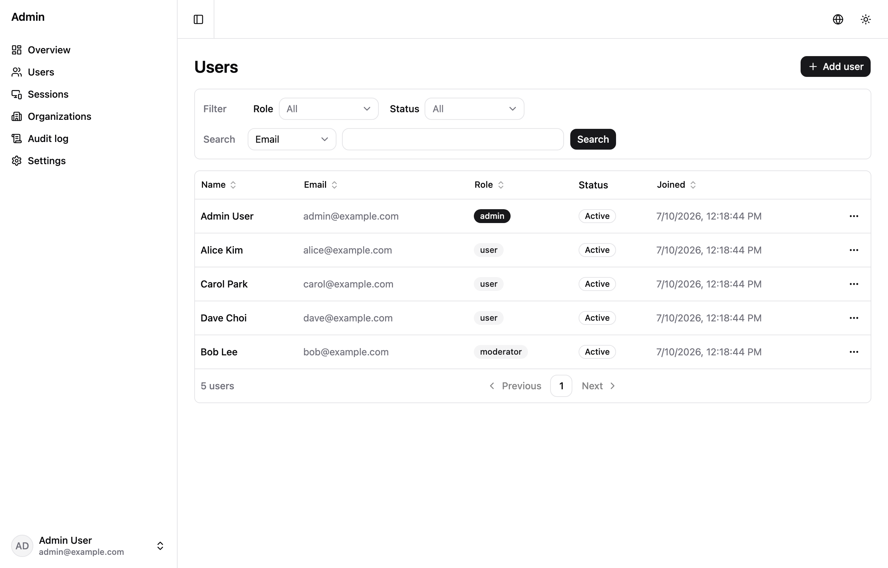
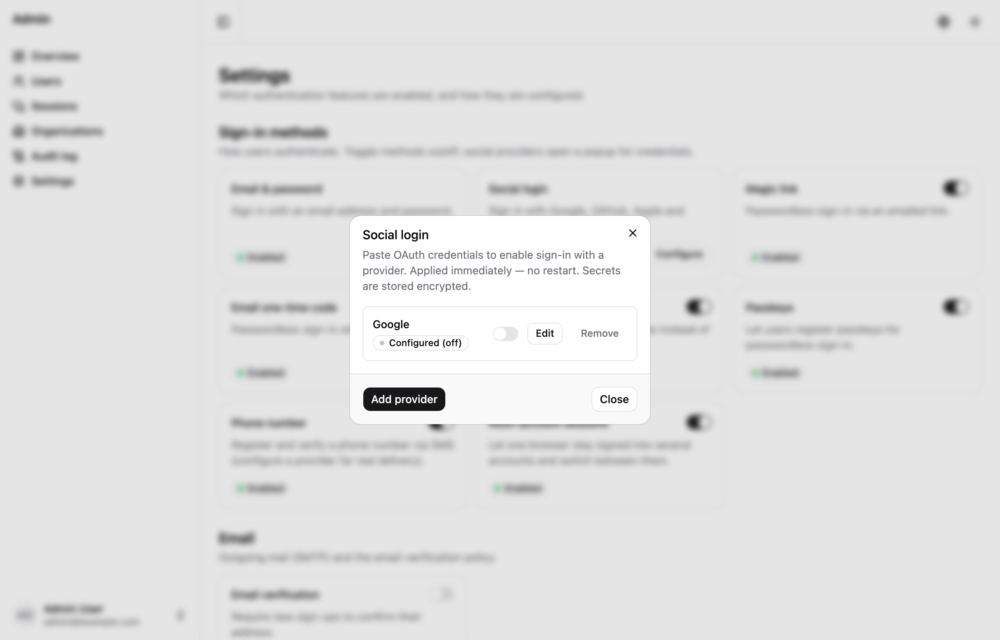

# Modules (`podo add`)

Add composable features to an existing generated project without duplicating a
whole template. Run inside a project created by `podo create`:

```bash
cd my-app
npx @podosoft/podokit add <module>
```

Generated PodoKit v1 applications use Bun 1.4.0. Install dependencies with
`bun install`, invoke package CLIs with `bunx`, use `bun run` for root scripts,
and run API scripts as `bun run --cwd apps/api <script>`.

`podo add` (with no module) lists what's available. Modules can depend on other modules — required modules are added automatically. Each module:

- overlays its files into the project,
- merges its dependencies into the target app's `package.json`,
- appends any environment variables to `.env.example`,
- wires its Elysia plugin and startup services into `app.ts` at marker comments,
- may declare `ownedGlobs` (paths it ships as user-owned — e.g. public pages you
  restyle — merged into your project so `podo update` never touches them; see
  [updating](updating.md#project-metadata)),
- may declare `managedOverrides` for module-owned files inside a broadly owned
  area, such as a generated `.claude/skills/<module>/**` workflow or an exact
  route server loader that must keep receiving behavioral and security updates;
  presentation routes and the application root layout stay owned, and
- may declare `requiredProjectFiles` and `requiredProjectContents` when an
  overlay depends on newer generated baseline paths or source contracts; the CLI
  checks them before mutation and asks you to run
  `podo update --apply` when the project is stale,
- may declare `apiPaths`, prefixes under `/api/` that its routes need sent
  straight to the API (see [Module direct API paths](#module-direct-api-paths)),
  and
- prints follow-up steps.

## Provider capabilities

Feature modules declare capabilities instead of concrete infrastructure. The CLI
adds the implementation selected in `.podokit/manifest.json`:

| Capability | Default | Alternative | Used by |
| --- | --- | --- | --- |
| `database` | `postgres` | `sqlite` | core queries, auth, migrations, local jobs |
| `cache` | `redis` | `memory` | rate limiting and application caches |
| `object-storage` | `s3` | `local` | file upload, profile images, content modules |
| `events` | `redis` | `memory` | SSE and job progress |
| `jobs` | `bullmq` | `local` | background work and job progress |

A simple app can use SQLite, memory cache/events, local files, and local jobs.
Configure the providers before adding features: `file-upload` then selects
`object-storage-local`, `rate-limit` selects `cache-memory`, and `job-progress`
selects `jobs-local`, `events-memory`, and `sse`. With the defaults, the same
features select S3, Redis, and BullMQ implementations. Creating a project records
these choices but does not install every optional implementation module.

Inspect or change them with `podo provider list` and `podo provider set
<capability> <provider> [--apply]`. The set command previews by default. It does
not migrate or delete provider data. Local providers require one API process;
read [Runtime providers](providers.md) before deployment or data migration.
For a complete setup sequence, use
[Getting Started](getting-started.md#small-app-with-local-providers).

## Available modules

### External package modules

PodoKit can load a module from an installed package named
`@podosoft/podokit-module-<name>`. Install the package in the generated project's
root, then add it by its short name:

```bash
bun add --dev @podosoft/podokit-module-blog
podo add blog
```

The project manifest records the package name and applied version. After
upgrading the package, `podo update` resolves it from the generated project's
`node_modules` and previews its managed-file changes. Public presentation routes
can remain app-owned while reusable API and `#lib` paths continue to update.

If an application already has the same feature and the package declares explicit
`managedGlobs`, use `--adopt` to hand only those paths back to the module. Existing
owned presentation paths are preserved:

```bash
podo add blog --adopt
```

### `blog` (external package)

Authenticated Markdown publishing with image attachments, paginated public posts,
flat comments, author ownership, and admin management. Posts start as private
drafts. Authors manage drafts and published posts at `/blog/mine`, use **Show post**
to control public visibility, and can edit or delete only their own posts and
comments; admins can manage all content. Hiding and showing an existing post keeps
its first publication time and public list position.

```bash
bun add --dev @podosoft/podokit-module-blog
podo add blog
bun install
bun run --cwd apps/api migration:run
```

The module keeps `apps/api/src/blog/**`, reusable `#lib/blog/**`, and its tests
managed. Public `/blog` route wrappers and `/admin/blog` presentation files are
owned so applications can implement their own design and SEO. The additive
migration preserves an existing `blog_posts` table, adds author snapshots and
ownership, and creates comments with post-cascade deletion.

Use the managed `BlogProse` component in an application-owned article route. It
shares a safe GFM renderer with `BlogEditor`, keeping preview and published body
markup and typography consistent while the surrounding article layout stays
application-owned.

`BlogEditor` uploads PNG, JPEG, GIF, WebP, and AVIF files up to 5 MB to object
storage, then inserts a Markdown image at the current cursor. The resulting
`/api/blog/images/:id` URL is public, stable, and cacheable, unlike a presigned
file-upload URL. SVG is excluded from inline blog uploads.
The editor also uploads and previews one cover image for each post.

### `analytics` (external package)

Provider-neutral, privacy-aware web analytics with Google Analytics 4 as the
first provider. The module adds anonymous page and application event collection,
advanced Consent Mode v2, encrypted administrator configuration, aggregate
traffic and key-event reports, and a realtime 30-minute visitor view. It never
stores raw visitor events in the application database.

```bash
bun add --dev @podosoft/podokit-module-analytics
podo add analytics
bun install
bun run --cwd apps/api migration:run
```

Administrators enter a GA4 measurement ID, numeric property ID, and a
least-privilege service-account JSON credential under **Settings → Analytics**.
The credential is write-only in the browser and encrypted at rest with the key
derived from `BETTER_AUTH_SECRET`. Grant the service account Viewer access to the
GA4 property and enable the Google Analytics Data API in its Google Cloud
project. Test the connection before enabling collection. Reports are available
at `/admin/analytics`; successful report responses are cached for five minutes
and realtime responses for 60 seconds.
The settings card also provides a scrollable credential guide covering the
measurement and property identifiers, Data API activation, dedicated service
account creation, Viewer access, JSON key handling, and official Google
documentation links.

The browser runtime starts analytics and advertising consent denied. Accepting
grants only analytics storage; advertising storage, user data, and
personalization remain denied. Advanced mode means Google can still receive
cookieless pings after a visitor declines, so applications must explain that in
their privacy notice and keep the consent-settings control visible.

PodoKit does not send authenticated user IDs, names, or email addresses. It
measures public and signed-in product routes, excludes admin, auth, account,
maintenance, and error routes, and strips query strings and fragments. Customize
sensitive application paths in the owned
`apps/web/src/lib/analytics.config.ts`. Track product goals through the
provider-neutral helper:

```ts
import { trackAnalyticsEvent } from "#lib/analytics.js";

trackAnalyticsEvent("generate_lead", { method: "contact_form" });
```

Mark product-goal events as key events in the GA4 property so the aggregate
key-event metrics include them.

Disable GA4 enhanced measurement's history-based page changes because the
SvelteKit runtime sends one manual `page_view` for each navigation.

### `auth` (better-auth)

Full authentication built on [better-auth](https://better-auth.com): email/password
and sessions out of the box, plus **OAuth** and **2FA** enabled by configuration.
Adding it installs a **global Elysia request guard**, so the API is **secure by default** —
every route requires a session except `/health` and `/api/auth/*`. Opt routes out
by registering a public access policy; read the current user through `AuthService`.
Modules that must also work without `auth` read the caller through the core
`REQUEST_IDENTITY` service instead. It answers four questions about a request:
`userId(request)`, `isAdmin(request)`, `roles(request)`, and
`activeOrganizationId(request)`. Without an identity provider every request is
anonymous: `undefined`, `false`, `[]`, and `undefined`. With `auth`, `roles`
returns the user's roles as an array (the admin plugin's comma-separated value is
split for you) and `activeOrganizationId` returns the session's active
organization when the organization plugin has set one. All four share the one
session lookup memoized per request, so asking several costs a single read.

```bash
bunx @podosoft/podokit add auth
bun install
# create the Better Auth and application tables
bun run --cwd apps/api migrate:all
bun run dev

# sign up (sets a session cookie), then call a protected route
curl -c cookies.txt -XPOST localhost:5002/api/auth/sign-up/email \
  -H 'content-type: application/json' -d '{"email":"a@example.com","password":"password123","name":"A"}'
curl -b cookies.txt localhost:5002/account/me
```

The authentication module requires Better Auth 1.7.7 and uses the version
installed by the application for migrations. Before applying the current
schema, it checks duplicate `(providerId, accountId)` identities and cleans up
obsolete 1.7.0–1.7.2 issuer constraints in PostgreSQL or SQLite. Back up existing
databases and resolve reported collisions manually; see
[authentication upgrade guidance](updating.md#compatibility-ranges).

Run the same command in development and from a built production image. It applies
both the Better Auth schema and application migrations for the selected
PostgreSQL or SQLite database without downloading a CLI:

```bash
bun run --cwd apps/api migrate:all
```

The command selects `src/migrate.ts` during development and `dist/migrate.js`
inside a built image, exits non-zero on failure, and is suitable for a Kubernetes
migration Job before a rolling deployment.

- **Secure by default**: all module endpoints (jobs, storage, files, cache, …) are protected once `auth` is added.
- **Configure it in the admin Settings page, not env.** Social OAuth providers, SMTP, the
  server-enforced toggles (email verification, sign-up approval, automatic logout, breached-password check, account deletion, and —
  with the audit-log module — audit logging), and the feature flags (2FA, magic link, email OTP,
  username, multi-session, phone number, …) are all stored in the DB and **applied live — no
  restart** (paste a client id/secret and social login works on the next request). Only
  `BETTER_AUTH_SECRET` and `BETTER_AUTH_URL` are required env vars; the rest are optional
  fallbacks/overrides that the DB config takes precedence over (handy for secrets-manager
  injection in production).
- **How settings changes reach every replica.** `auth_config` and `app_setting` share one
  in-process snapshot. The replica that handled a write applies it before responding. Other
  replicas run one version probe (row count and latest update time of both tables) at most every
  3 seconds, and read the tables again only when the probe changes, so they converge within
  3 seconds, deleted providers included. When the app has an events provider (`events-redis`
  across replicas), a write also publishes `config.changed` so the other replicas reload at once;
  without one they rely on the probe. An auth request waits for the probe at most
  `READINESS_CHECK_TIMEOUT_MS`; when the database answers later, the current configuration
  serves that request and the probe finishes in the background.
- **Social login is dynamic.** The "Social login" card manages providers add/edit/delete: pick
  any better-auth-supported provider (Google, GitHub, Apple, Microsoft, Discord, Kakao, Naver,
  … — see `auth/auth-config.ts` `SUPPORTED_SOCIAL_PROVIDERS`), paste its client id/secret, and it
  takes effect on the next request. Each provider is one `social.<id>` row in `auth_config`;
  removing it deletes the row. `GOOGLE_CLIENT_*` / `GITHUB_CLIENT_*` env vars still seed those two
  as a fallback. Enabled providers appear automatically on `/login`; OAuth failures return to the
  login origin through `errorCallbackURL`.
- **Sign-up approval is provider-independent.** Turn on *Sign-up approval* in Settings to mark
  every new self-registered account as pending, whether it came from email/password, Google,
  Apple, magic link, or another provider. Pending accounts cannot create a session and receive the
  stable `SIGNUP_APPROVAL_REQUIRED` code. Existing users, `ADMIN_EMAILS`, and users created by an
  administrator remain approved. Turning the policy off auto-approves future registrations; it
  does not silently approve the existing queue. Approve those users from `/admin/users`.
- **Automatic logout is server-enforced.** Turn on *Automatic logout* in Settings and choose an
  idle period from 5 minutes through 7 days. Better Auth uses a sliding session expiration, while
  the generated browser runtime observes user activity across tabs, refreshes active sessions at
  a bounded cadence, and returns an inactive user to `/login`. Enabling or changing the policy
  resets existing session expirations from the change time, so it applies without a restart or a
  new sign-in. `AUTH_SESSION_IDLE_TIMEOUT_MINUTES` is the optional environment fallback; the DB
  setting takes precedence and `null` preserves Better Auth's default seven-day lifetime.
- **Closing public sign-up is provider-independent.** Turn off *Allow public sign-up* under
  Settings → General to reject every new self-registration path with the stable
  `PUBLIC_SIGNUP_DISABLED` code. Email, Google, Apple, magic-link, and future providers all use
  the same new-user database gate. Existing users can still sign in with any enabled method, and
  administrators can still create users deliberately from `/admin/users`.
- **Use a stable HTTPS origin for development OAuth.** Keep portless `*.localhost` for normal
  multi-app work, then expose the web container through a Cloudflare Named Tunnel, reserved ngrok
  domain, or preview deployment for provider callbacks. Register the exact HTTPS origin and
  `/api/auth/callback/google`, and use a separate Google Cloud project/client for development.
  Admin Settings persists the displayed callback when the provider is saved, and `auth:configure`
  derives and persists it from `AUTH_SETUP_ORIGIN` unless `OAUTH_REDIRECT_URI` explicitly overrides
  it. Use `--redirect-only` to repair a stale callback while preserving the stored credentials and
  enabled state. See [OAuth development over HTTPS](oauth-development.md).
- **Automate provider and SMTP configuration.** Generated APIs include a redacting admin-API
  helper. Pass secrets through environment variables, never command arguments:

  ```bash
  export AUTH_SETUP_ORIGIN="https://example.com"
  export AUTH_SETUP_ADMIN_EMAIL="admin@example.com"
  export AUTH_SETUP_ADMIN_PASSWORD="<from-secret-manager>"
  export OAUTH_CLIENT_ID="<provider-client-id>"
  export OAUTH_CLIENT_SECRET="<from-secret-manager>"
  bun run --cwd apps/api auth:configure --provider google --require-signup-approval --dry-run
  bun run --cwd apps/api auth:configure --provider google --require-signup-approval
  bun run --cwd apps/api auth:configure --provider google --check-only
  ```

  The generated `.claude/skills/podokit-configure-auth` skill contains Google, Apple, SMTP relay,
  secret-handling, callback, and verification workflows.
- **Secrets are encrypted at rest**: OAuth client secrets and the SMTP password are stored with
  AES-256-GCM, the key derived from `BETTER_AUTH_SECRET` (never in the DB it protects). They are
  never returned to the browser (the API exposes only a `hasSecret` flag). Keep
  `BETTER_AUTH_SECRET` stable — rotating it makes previously-saved DB secrets undecryptable.
- **Database outages answer 503.** While PostgreSQL is unreachable, Better Auth endpoints such
  as `POST /api/auth/sign-in/email` and `GET /api/auth/get-session`, and every route that needs a
  session, answer `503` with `DATABASE_UNAVAILABLE` and `Retry-After` instead of `500`. Better
  Auth reports a failed query as a bare `500`, and its session lookup drops the cause, so after a
  server error the module runs `SELECT 1` on its pool, bounded by `READINESS_CHECK_TIMEOUT_MS`,
  and answers `503` only when that fails too. Client errors such as `401` and other `500` errors
  are passed on unchanged. A query that PostgreSQL leaves unanswered, for example while the
  server is paused, fails after `DB_QUERY_TIMEOUT_MS` (default `10000`), and the pool closes
  that connection and opens a new one instead of reusing it. The migration runner and
  `admin:bootstrap` run without that timeout: they import `./auth/maintenance-command` first,
  which also skips Better Auth's startup schema check for their process.
- **Bearer tokens (API/mobile clients)**: always on. Sign-in returns the session token in
  a `set-auth-token` response header; send it back as `Authorization: Bearer <token>` to
  authenticate without a cookie. Useful for native apps and server-to-server calls.
  The value is signed (`<token>.<signature>`, the same value as the session cookie) and
  must be sent unchanged: an unsigned session token, such as the `session.token` field
  returned by `get-session`, is ignored. Other bearer credentials, such as API keys or OAuth
  access tokens, therefore never trigger a session lookup.

  ```bash
  # grab the token from the sign-in response header, then call a protected route with it
  TOKEN=$(curl -si -XPOST localhost:5002/api/auth/sign-in/email \
    -H 'content-type: application/json' -d '{"email":"a@example.com","password":"password123"}' \
    | awk -F': ' 'tolower($1)=="set-auth-token"{print $2}' | tr -d '\r')
  curl -H "Authorization: Bearer $TOKEN" localhost:5002/account/me
  ```
- **Two-factor with backup codes**: when 2FA is enabled, the login page shows a
  second-factor step with a **"use a backup code"** option, so a user without
  their authenticator can still sign in with a one-time code. The account page
  lets them download the codes and regenerate a fresh set (invalidating the old).
- **Require two-factor** (admin Settings toggle, off by default): forces every
  user to enrol in 2FA before using the app — un-enrolled users are redirected to
  `/setup-2fa`, and the API rejects their requests (`TWO_FACTOR_REQUIRED`, via a
  global guard) until they do. Machine clients (api-key/bearer) are exempt.
- Security/audit modules build on this (they require `auth`).


### `mailer`

Reusable email sending. `auth` (and later `contact-form`) depend on it, so it is
usually added automatically.

```bash
npx @podosoft/podokit add mailer
```

```ts
import { sendMail, actionEmail } from "../mail/mailer"; // path relative to your file
await sendMail({ to: "a@example.com", subject: "Hi", text: "Hello", html: actionEmail(...) });
```

- **SMTP resolution** (applied live through the shared settings snapshot, within
  about 3 seconds): admin Settings page (DB, when `auth` is installed) → `SMTP_*`
  env → none, in which case messages are logged to the console so dev links stay
  grabbable. The transport is rebuilt only when the SMTP settings change.
- Depends on no other module (reads the DB SMTP config defensively), so `auth`
  can require it without a cycle.
- **Override the transport** (e.g. a provider SDK) from the owned DI slot
  `apps/api/src/app.extensions.ts`: `import { setMailTransport } from "./mail/mailer"; setMailTransport(myTransport)`.


### `bullmq`

Background jobs with [BullMQ](https://docs.bullmq.io): a demo queue, enqueue/
status endpoints on the API, and a **separate worker process** that consumes
jobs (the standard production shape — workers scale independently of the API).
Needs Redis and is active when the `jobs` capability selects `bullmq`.

```bash
npx @podosoft/podokit add bullmq
bun install
docker compose -f infra/docker/docker-compose.yml up -d   # postgres + redis

# terminal 1 — API (producer)
bun run dev
# terminal 2 — worker (consumer)
bun run --cwd apps/api dev:worker

curl -XPOST localhost:5002/jobs -H 'content-type: application/json' -d '{"text":"hello"}'
curl localhost:5002/jobs/<id>   # waiting -> active -> completed
```

Without the worker running, jobs stay `waiting`; start the worker and they complete.

The API adds and reads jobs over one producer connection that fails fast
instead of waiting for Redis. While Redis is down, `POST /jobs`, `GET /jobs/{id}`,
and every other `JOBS` call answer `503` with `JOBS_UNAVAILABLE` and
`Retry-After` at once. A command that Redis does not answer within
`REDIS_COMMAND_TIMEOUT_MS`, for example while the server is paused, fails the
same way, and the connection is replaced. The API starts while Redis is down,
reconnects the producer in the background like its other dependencies, and
reports it as the `jobs` readiness check. Workers keep BullMQ's blocking
connections, which wait for Redis instead of failing, and reconnect by
themselves with the same backoff, from 250 ms up to 5 seconds, so they resume
processing shortly after Redis returns. A job whose enqueue timed out may still
be added if the server resumes; pass `deduplicationKey` when a retried enqueue
must not create a second job.

### `jobs-local`

A database-persistent job queue with an embedded worker in the API process. It
implements the same `JOBS` contract as BullMQ and is selected with:

```bash
podo provider set jobs local --apply
```

Use it for desktop and single-process applications. It does not start a separate
worker and must not be scaled to multiple API replicas. The worker creates its
table and starts polling once the database is reachable, so an API that starts
while PostgreSQL is down begins processing jobs when it returns.

**Deployment.** The worker is a separate process, so `podo add bullmq` also adds:

- `infra/k3s/worker-deployment.yaml` — runs the API image with `bun dist/main-worker.js` (no Service/Ingress).
- `infra/docker/worker.compose.example.yml` — an example worker service for a containerized Compose deployment.

Run it in production as `bun run --cwd apps/api start:worker` (or the container
command `bun dist/main-worker.js`).

### `object-storage-s3`

S3-compatible object storage that works with **AWS S3 and MinIO-compatible servers**,
selected by the `STORAGE_PROVIDER` env var (`minio` or `aws`). Local development
uses a pinned [Silo](https://github.com/pgsty/silo) image. Provides a `StorageService`
(put, buffered `get`, streamed `open`, `stat`, paged `list`, delete, and presigned URLs) and demo
`/storage` endpoints. `open(key)` sends one GET and takes the object's metadata
from its response, reading objects up to 2 MiB into memory so responses built
from them keep their `content-length`; larger objects stream, chunked. Read or
cancel the body it returns. Prefer it to `get` for anything that can be large.
The Compose service and file keep their `minio` names for existing endpoints.

**Security note:** the demo endpoints require the `auth` module and an
**administrator** session (401 without a session, 403 for other users). `:key`
is a single name such as `hello`, stored as the object `demo/hello`. Names with
slashes (including an encoded `%2F`) or a leading dot are rejected, so the demo
cannot read or overwrite objects owned by other features, such as uploads,
profile images, or the site favicon. Objects written by earlier versions at the
bucket root are no longer reachable through these routes.

```bash
npx @podosoft/podokit add object-storage-s3
bun install

# local dev with Silo
docker compose -f infra/docker/docker-compose.yml -f infra/docker/minio.compose.yml up -d
bun run dev

# sign in as an administrator (for example an ADMIN_EMAILS account)
curl -c cookies.txt -XPOST localhost:5002/api/auth/sign-in/email \
  -H 'content-type: application/json' -d '{"email":"admin@example.com","password":"<password>"}'
curl -b cookies.txt -XPUT localhost:5002/storage/hello -H 'content-type: application/json' -d '{"content":"hi"}'
curl -b cookies.txt localhost:5002/storage/hello            # hi (streamed, with ETag)
curl -b cookies.txt localhost:5002/storage/hello/presigned  # { url } for demo/hello
```

**Providers** (set in `.env`):

- **Silo or MinIO-compatible storage** (default, for dev): `STORAGE_PROVIDER=minio`, `S3_ENDPOINT=http://localhost:9000`, `S3_FORCE_PATH_STYLE=true`, `S3_ACCESS_KEY_ID`/`S3_SECRET_ACCESS_KEY`.
- **AWS S3**: `STORAGE_PROVIDER=aws`, remove `S3_ENDPOINT`, `S3_FORCE_PATH_STYLE=false`, real credentials, and a pre-created bucket/region.

The same native `Bun.S3Client` code path serves both — only configuration differs.
The module registers a bucket probe with `/health/ready`, so an unavailable or
unauthorized bucket removes the API pod from service without failing liveness.

`OBJECT_STORAGE.put` streams large and streamed bodies as a multipart upload
with bounded memory, and the store implements the runtime multipart API
(`createMultipartUpload`, `uploadPart`, `completeMultipartUpload`,
`abortMultipartUpload`) for uploads split across requests. Bun's `S3Client`
has no multipart calls, so these requests are signed with AWS Signature
Version 4 from the same `S3_*` settings; set `S3_ACCESS_KEY_ID` and
`S3_SECRET_ACCESS_KEY` (or `AWS_ACCESS_KEY_ID` and `AWS_SECRET_ACCESS_KEY`, and
`S3_SESSION_TOKEN` or `AWS_SESSION_TOKEN` for temporary credentials). Keys
with `.` or `..` segments are rejected for writes because a request URL would
resolve them to another key. On AWS, add an `AbortIncompleteMultipartUpload`
lifecycle rule so abandoned uploads stop accruing storage. See
[Object storage writes](providers.md#object-storage-writes).

Applications that wrote their own S3 multipart writer to store large files
can call `put` with the stream, or the multipart API, instead.

### `object-storage-local`

Atomic, path-confined object storage rooted at `LOCAL_STORAGE_PATH`. It rejects
absolute paths, traversal, and symbolic-link escapes and implements the same
`OBJECT_STORAGE` contract as S3.

```bash
podo provider set object-storage local --apply
```

Use an absolute path for packaged or production applications and back it up with
the database. Local files are single-host and require one API replica.

**Security note:** download URLs work like S3 presigned URLs.
`getDownloadUrl()` returns `/files/content/<key>?expires=…&signature=…`, signed
with HMAC-SHA256 and valid for one hour by default (at most seven days).
`GET /files/content/*` is public but serves an object only for an unaltered,
unexpired signature; anything else returns 403 `DOWNLOAD_URL_INVALID`. The
signing key is created on first use at
`LOCAL_STORAGE_PATH/.podokit/download-url.key` with mode `0600`; deleting it
invalidates every issued URL. Unsigned `/files/content/...` URLs issued by
earlier versions stop working, so store object keys rather than URLs and request
a fresh URL when needed.

The module serves the same administrator-only demo routes as `object-storage-s3`
(`PUT /storage/:key`, `GET /storage/:key`, `GET /storage/:key/presigned`),
confined to `demo/`.

Downloads and demo reads stream the file from disk in 64 KiB chunks. Each
response carries `etag` and `last-modified`, and a matching `If-None-Match`
receives `304` without reading the file. The chunks come from a JavaScript
`ReadableStream`, which Bun sends with `Transfer-Encoding: chunked`, dropping
the `Content-Length` that `objectResponse` sets; only very small objects
sometimes keep it.

Streamed `put` bodies are written to a temporary file and renamed into place.
Multipart uploads keep their parts under
`LOCAL_STORAGE_PATH/.podokit/multipart/<uploadId>/` and follow the same rules
as S3, including the 5 MiB minimum for every part but the last. Uploads idle
for longer than `LOCAL_STORAGE_MULTIPART_MAX_AGE` seconds (default 86400) are
removed when a later upload starts.

### `file-upload`

A multipart upload endpoint and resumable chunked uploads that store files
through the `OBJECT_STORAGE` contract and return a download URL. `podo add
file-upload` automatically adds the selected S3 or local implementation.

```bash
npx @podosoft/podokit add file-upload   # also adds the selected provider
bun install
docker compose -f infra/docker/docker-compose.yml -f infra/docker/minio.compose.yml up -d
bun run dev

curl -b cookies.txt -F 'file=@./photo.png' localhost:5002/files
# → { key, url }  (presigned for S3, a signed API path for local storage)
curl -b cookies.txt localhost:5002/files/uploads%2F<userId>%2F<file>/url
# → { url }  (owner or administrator only)
```

**Security note:** uploads are stored per user as
`uploads/<userId>/<uuid>-<name>`. `GET /files/:key/url` takes the full key,
URL-encoded as one path segment, and presigns it only for:

- the user whose id is the key's owner segment, or
- an administrator, who may presign any upload key.

Other signed-in users receive 403 `FILE_FORBIDDEN`. Keys outside `uploads/`,
such as profile images or the site favicon, return 404 `FILE_NOT_FOUND` for
everyone, so the endpoint can no longer presign arbitrary objects. Add the `auth`
module so uploads have an owner. In an app without `auth`, uploads keep the
unowned `uploads/<uuid>-<name>` format and every caller may presign them, as
before.

Uploads stored by earlier versions use that unowned format. Once `auth` is
installed, only administrators can presign them. To return such files to their
owners, move each object to `uploads/<userId>/<name>` using ownership your
application already records.

#### Resumable uploads

`POST /files` takes the whole file in one request, so it is bounded by the web
server's `BODY_SIZE_LIMIT` and restarts from zero when the connection drops.
For large files, the module also provides resumable uploads: the client creates
an upload session, sends the file in numbered parts, and completes it. Each
part is streamed into an object storage multipart upload without being
buffered whole, a failed part is simply sent again, and a client that lost its
place reads which parts the server already has.

Sessions and received parts are stored in the database
(`file_upload_sessions` and `file_upload_parts`), never in process memory, so
any API replica can serve any request of an upload. Every state change is a
conditional `UPDATE`: two concurrent completes produce one object, and replicas
sweeping expired sessions at the same time never abort the same upload twice.
Run the migration after adding the module:

```bash
bun run --cwd apps/api migration:run   # or migrate:all with the auth module
```

In the browser, use the managed helper `$lib/uploads`:

```ts
import { resumeUpload, uploadFile } from "$lib/uploads";

const controller = new AbortController();
const stored = await uploadFile(file, {
  onProgress: (sent, total) => (progress = sent / total),
  onSession: ({ id }) => localStorage.setItem("upload", id), // to resume after a reload
  signal: controller.signal, // abort() cancels the upload on the server
});
// stored = { id, status: "completed", key, size, contentType, url }

// After a reload, with the same File:
await resumeUpload(localStorage.getItem("upload") ?? "", file);
```

`uploadFile` sends three parts at a time (`concurrency`), retries a part that
fails with a network error, 408, 425, 429, or 5xx up to five times (`retries`)
with exponential backoff from 500 ms (`retryDelayMs`), and waits for the
server's `Retry-After` when there is one. In a browser with the default client,
parts go out with `XMLHttpRequest`, so `onProgress` reports bytes as they are
sent. With a custom `client`, or where `XMLHttpRequest` does not exist (tests,
server-side code), parts use the client's `fetch` and progress advances as each
part is stored. The reported value never decreases: the bytes of a part that
fails stop counting, and progress holds until its retry passes them. Aborting
the signal stops the transfer, including the requests in flight, and deletes the
session.

The HTTP contract, as the API receives it (the browser calls the same paths
under `/api`):

| Request | Body | Response |
| --- | --- | --- |
| `POST /files/uploads` | `application/json`: `{ filename, size, contentType? }` | `201 { id, partSize, partCount, expiresAt }` |
| `PUT /files/uploads/{id}/parts/{partNumber}` | `application/octet-stream`, the part's bytes, `Content-Length` equal to `partSize` (the last part holds the remainder) | `200 { partNumber, size }` |
| `GET /files/uploads/{id}` | | `200 { id, status, filename, contentType, size, partSize, partCount, receivedParts, expiresAt, key? }` |
| `POST /files/uploads/{id}/complete` | `application/json`: `{}` | `200 { id, status: "completed", key, size, contentType, url }` |
| `DELETE /files/uploads/{id}` | | `204` |

Parts may arrive in any order, and sending a part again replaces it. `status`
is `open`, `completing`, `completed`, or `aborted`; `key` appears once the upload
has completed. Completing a completed upload returns the same result, and
deleting an aborted one succeeds. Uploads are stored as
`uploads/<userId>/<id>-<filename>`, so `GET /files/{key}/url` presigns them like
any other upload.

| Error code | Status | Meaning |
| --- | --- | --- |
| `UPLOAD_NOT_FOUND` | 404 | No such session, it belongs to another user, or storage no longer has it. Other users always receive 404, never 403. |
| `UPLOAD_SIZE_INVALID` | 400 | `size` is not a positive whole number of bytes. |
| `UPLOAD_TOO_LARGE` | 413 | `size` is above `FILE_UPLOAD_MAX_BYTES`. |
| `UPLOAD_PART_OUT_OF_RANGE` | 400 | The part number is not between 1 and `partCount`. |
| `UPLOAD_LENGTH_REQUIRED` | 411 | The part was sent without `Content-Length`. |
| `UPLOAD_PART_SIZE_MISMATCH` | 400 | `Content-Length`, or the body actually received, differs from the part's size. |
| `UPLOAD_INCOMPLETE` | 409 | Complete was called before every part arrived; read the status and send the missing parts. |
| `UPLOAD_COMPLETING` | 409 | Another request is completing the upload; retry shortly. |
| `UPLOAD_COMPLETED` | 409 | A part or delete arrived after completion. |
| `UPLOAD_INVALID_PART` | 409 | Storage rejected a stored part as changed; send the parts again. |
| `UPLOAD_CONFLICT` | 409 | The upload changed state while a part was being stored; read the status. |
| `UPLOAD_EXPIRED`, `UPLOAD_ABORTED` | 410 | The session expired or was cancelled; start a new upload. |
| `UNSUPPORTED_MEDIA_TYPE` | 415 | A POST without `application/json` or a part without `application/octet-stream`. |
| `ORIGIN_NOT_ALLOWED` | 403 | A browser `Origin` outside `CORS_ORIGIN`. |

The content-type rule keeps every cross-origin browser call to these routes
from being a CORS "simple" request: the browser must send a preflight first,
and the API's CORS refuses origins outside `CORS_ORIGIN`. This matters because
a direct API path skips the web server's cross-site form check. A browser
`Origin` header outside `CORS_ORIGIN` is also rejected outright; requests
without one, such as `curl`, are authenticated by the session alone.

| Variable | Default | Purpose |
| --- | --- | --- |
| `FILE_UPLOAD_MAX_BYTES` | `1073741824` (1 GiB) | Largest file one upload may hold. |
| `FILE_UPLOAD_PART_BYTES` | `8388608` (8 MiB) | Part size, at least 5 MiB (the S3 minimum). Files that would need more than 10,000 parts get larger parts, in whole MiB. |
| `FILE_UPLOAD_SESSION_TTL` | `86400` | Seconds an unfinished upload may sit idle; each stored part restarts the clock. With local storage, keep it at or below `LOCAL_STORAGE_MULTIPART_MAX_AGE`. |
| `FILE_UPLOAD_SWEEP_INTERVAL` | `300` | Seconds between sweeps that abort expired uploads, retry failed storage aborts, and delete finished sessions a TTL after they end. `0` turns the sweep off. |
| `FILE_UPLOAD_RATE_LIMIT_MAX` | `3000` | Part uploads per caller in each `RATE_LIMIT_TTL` window. |

The part size of the largest allowed upload must fit in the API's request body
limit (`API_MAX_REQUEST_BODY_SIZE`, 128 MiB by default, or `apiServerOptions`);
the API refuses to start otherwise. The S3 provider holds each part in memory
while it sends it, so keep parts in the tens of MiB: three 8 MiB parts in flight
added about 47 MiB of API memory in a 40 MiB upload to Silo. With the
`rate-limit` module installed, part uploads count against their own
`file-uploads` budget instead of the general one.

**Parts go past the web server.** Parts are larger than the web server's
`BODY_SIZE_LIMIT` (3 MiB by default), so a production build answers `413` if
they go through the `/api` proxy. The module declares `/api/files/uploads/` as a
[direct API path](deployment.md#direct-api-paths), and `podo add file-upload`
lists it in `.podokit/dev.json` for `podo dev` and in `exposure.apiPaths` of
every deployment profile under `.podokit/deploy/`:

```json
{
  "exposure": {
    "apiPaths": ["/api/files/uploads/"]
  }
}
```

`podo deploy init` adds it to profiles created later, and `podo remove
file-upload` takes it out again. A profile that cannot take the path, such as a
Kubernetes profile with `nodePort` exposure, is left unchanged and reported; see
[Module direct API paths](#module-direct-api-paths). The Vite development server
sets no body limit, so `bun run dev` without a gateway also accepts the parts
through the proxy. Requests on the direct path reach the API with the gateway's
timeouts; see [direct API paths](deployment.md#direct-api-paths) for raising
Traefik's read timeout on slow connections.

### `sse`

Server-Sent Events scoped by topic and audience. The module provides:

- `GET /events/stream?topics=a,b` for signed-in users.
- `POST /events`, a broadcast tool for administrators.
- `EventsService`, which any module (a queue processor, for example) uses to
  publish.
- A browser helper in `$lib/events` that shares one `EventSource` per tab.

```bash
npx @podosoft/podokit add sse
bun run dev

# terminal 1 — stream as a signed-in user
curl -N -b cookies.txt 'localhost:5002/events/stream?topics=message'
# terminal 2 — publish as an administrator
curl -b admin-cookies.txt -XPOST localhost:5002/events \
  -H 'content-type: application/json' -d '{"message":"hello"}'
```

The selected `events` provider supplies the transport. `events-memory` is bounded
to one API process. `events-redis` uses the shared `REDIS_URL` or individual Redis
settings, creates dedicated publish/subscribe connections, and delivers across
API replicas. A Redis-configured application fails readiness instead of silently
falling back to process-local delivery.

#### Publishing

Modules publish an envelope with a topic, an optional audience, and JSON data:

```ts
const events = services.resolve(SSE_EVENTS);
events.publish({
  topic: "orders",
  audience: { userIds: [order.ownerId] },
  data: { orderId: order.id, status: "shipped" },
});
```

- `topic` and the optional `id` use letters, digits, `.`, `_`, `:`, and `-`,
  start with a letter or digit, and have at most 128 characters.
- `audience` limits who receives the event:
  - `userIds` matches the listed users.
  - `roles` matches users who hold any listed role.
  - `organizationId` matches users whose active organization is that one.
- When an audience sets several fields, a user must match every one of them.
  `{ organizationId: "o1", roles: ["admin"] }` reaches only the administrators of
  `o1`.
- An empty list such as `userIds: []` reaches nobody. An audience with no fields
  is rejected, because it is usually a recipient list that failed to resolve.
- Without an audience, every stream subscribed to the topic receives the event.

`publish()` is best-effort for domain operations that already committed their
state. Use `publishAsync()` when the caller must know that delivery failed, and
`publishLocal()` only for an event that another channel has already fanned out
to every API replica. For an invalid envelope, `publish()` and `publishLocal()`
throw `InvalidEventError` and `publishAsync()` rejects with it. Events are
at-most-once invalidation hints, so clients must reload authoritative state after
a resync or reconnect.

#### Subscribing

A stream needs a signed-in user. Each stream lists its topics in `topics`, up to
32 comma-separated names. Without `topics`, the stream carries every topic that
has no authorizer. The stream answers:

- 401 `AUTH_REQUIRED` without a user.
- 400 `EVENTS_TOPICS_INVALID` for a malformed list.
- 403 `EVENTS_TOPIC_FORBIDDEN` when an authorizer refuses a topic.
- 429 `EVENTS_STREAM_LIMIT` when the user already holds
  `SSE_MAX_STREAMS_PER_USER` open streams (default 8) on that API replica.

The stream limit refuses the new stream instead of closing an older one, because
a closed stream reconnects and would then refuse another tab in turn.
`$lib/events` retries a refused stream with backoff, so a tab connects once
another closes. Each replica counts only its own streams, so with several
replicas behind a load balancer a user can hold up to that many streams on each.

Any signed-in user may subscribe to a topic by default. Register an authorizer to
restrict a topic, or a pattern ending in `*` to restrict every topic with that
prefix. Every authorizer that matches a topic must allow the subscriber, and a
guarded topic must be requested by name:

```ts
const events = services.resolve(SSE_EVENTS);
events.topics.register("admin-alerts", (subscriber) => subscriber.roles.includes("admin"));
events.topics.register("project:*", async (subscriber, topic) =>
  projects.isMember(topic.slice("project:".length), subscriber.userId)
);
```

The stream resolves the subscriber's user id, roles, and active organization
once, when it connects, from the request identity (`roles(request)` and
`activeOrganizationId(request)`; the `auth` module implements both from the
session). Register an `EVENT_IDENTITY` in `app.extensions.ts` only to replace
that mapping, for example with application-specific roles:

```ts
import type { ServiceRegistry } from "./core/services";
import { EVENT_IDENTITY } from "./events/events.module";

export function configureServices(services: ServiceRegistry): void {
  services.register(EVENT_IDENTITY, {
    subscriber: async (request) => {
      const user = await currentAppUser(request); // your own lookup
      return user ? { userId: user.id, roles: user.roles, organizationId: user.teamId } : undefined;
    },
  });
}
```

Because the identity is fixed at connect, a stream ends after 30 minutes. The
client reconnects and is authorized again, so a revoked session or a removed role
stops receiving events within that time.

#### Wire format

The stream starts with `retry: 3000`. Each data event is a default `message`
event, so `EventSource.onmessage` receives it. Its data is `{ topic, data }` as
JSON, and its `id:` is the publisher's `id` or a sequence number for the
connection:

```text
retry: 3000

id: 1
data: {"topic":"orders","data":{"orderId":"o-1","status":"shipped"}}

event: resync
data: {}

: heartbeat
```

The stream also sends two control frames, and neither reaches `onmessage`:

- A named `resync` event tells the client that events were dropped and its state
  must be reloaded.
- A `: heartbeat` comment every five seconds keeps proxies and Bun's idle timeout
  from closing a quiet stream.

Event ids are not replayed. The stream ignores `Last-Event-ID`, so reload state
after every reconnect.

Each connection buffers at most 256 events. A client that falls further behind
loses the backlog and receives one `resync` instead of letting the queue grow
without bound. A connection uses one heartbeat timer. When the client disconnects,
the connection's subscription and timer are released at once.

Every open stream on a replica also receives one `resync` when that replica's
event transport delivers again after an outage, such as a Redis restart, because
events published in the meantime never reach it. The stream itself stays open.
A transport reports this through the optional `onInterruption(listener)` of the
runtime `EventBus` contract; the memory transport cannot lose events and leaves
it out.

#### Browser helper

`$lib/events` keeps one `EventSource` per tab and reference-counts subscribers.
It reconnects with exponential backoff (one to thirty seconds, with jitter) and
closes when the last subscriber leaves. A subscriber receives
`{ resync: true, topic }` after a server `resync` and after the stream
reconnects. Subscribe from `$effect` or `onMount`, so the stream opens only in
the browser:

```svelte
<script lang="ts">
  import { subscribe } from "$lib/events";

  let progress = $state(0);

  $effect(() =>
    subscribe("job-progress", (message) => {
      if (message.resync) void reload();
      else progress = (message.data as { progress: number }).progress;
    })
  );
</script>
```

#### Upgrading from the open broadcast stream

Earlier versions let any signed-in user broadcast to every stream, and every
stream received every event. Apps that relied on that behavior must change in
these ways:

- `POST /events` now requires an administrator. Other signed-in users receive
  403 `ADMIN_REQUIRED`. Publish from server code with `EventsService` instead.
- `EventsService.publish()`, `publishAsync()`, and `publishLocal()` take
  `{ topic, audience?, data, id? }` instead of a bare payload, and
  `EventsService.subscribe()` was removed. Choose a topic for each event, and set
  an audience for anything that belongs to particular users.
- Each data event's `data` is now `{ topic, data }`. `POST /events` publishes
  `{ topic: "message", data: { message } }` instead of
  `{ type: "message", message }`. Read the payload from `data`.
- Heartbeats are SSE comments and no longer reach `onmessage` as
  `{ type: "heartbeat" }` messages.
- The stream requires a signed-in user even when the route is public in your
  access policy, so add the `auth` module or another request identity provider.
- During a rolling deploy, replicas discard transport messages in the old format.

### `events-memory` and `events-redis`

These modules implement the `EVENTS` contract consumed by `sse` and
`job-progress`. Select memory for a single process or Redis for cross-replica
delivery:

```bash
podo provider set events memory --apply
podo provider set events redis --apply
```

Every replica subscribes to one transport topic. The SSE envelope travels whole,
including its topic and audience, and each replica filters for its own streams.
`SSE_MAX_EVENT_BYTES` limits the encoded envelope, audience included, on publish
and on receipt. Delivery is at-most-once. See [`sse`](#sse) for the publishing
API.

The Redis transport keeps its handlers in the process, so `subscribe` resolves
without Redis and handlers stay registered across reconnects. The API starts
while Redis is down; the transport reconnects in the background and subscribes
its channel again on a fresh connection after every drop, because Bun keeps the
listener of a dropped connection but not its server subscription. Publishing
fails at once while it is disconnected, and after `REDIS_COMMAND_TIMEOUT_MS`
when Redis keeps the connection open without answering, which the
`POST /events` route answers with 503 `EVENTS_TRANSPORT_UNAVAILABLE`. A
connection that timed out is closed and reopened. Events published while a replica is
disconnected are not replayed to it; its open streams receive one `resync` once
it is subscribed again. Settings change events (`config.changed`) use the same
subscription, so replicas return from the settings TTL to immediate updates
when Redis returns.

### `redis`

Bun's native Redis client with `get`/`set`/`del` and `publish`/`subscribe`,
exposed as the `CACHE` implementation plus demo `/cache` endpoints. BullMQ retains
its own transitive `ioredis` connection because that is BullMQ's supported
transport.

For production, prefer an authenticated `REDIS_URL`. `REDIS_USERNAME`,
`REDIS_PASSWORD`, `REDIS_DB`, and `REDIS_TLS=true` are also supported with the
individual host and port settings. The Redis module registers a readiness check,
and rate limiting, BullMQ, SSE, and the Redis service share the same connection
configuration without logging credentials.

The API starts while Redis is down and reconnects in the background, also after
Redis restarts (see [Health probes](deployment.md#health-probes)). While the
connection is closed, commands fail at once instead of queueing, so the cache
endpoints and the rate limiter answer with an error rather than waiting. A
command that Redis does not answer within `REDIS_COMMAND_TIMEOUT_MS` (default
`1000`), for example while the server is paused, fails with
`RedisCommandTimeoutError`. Redis answers a connection's commands in order, so
the connection is then closed, which fails the commands waiting behind it, and
reopened in the background. The demo cache endpoints answer `503` with
`CACHE_UNAVAILABLE` and `Retry-After` while Redis cannot be reached. Run other
commands through `redis.command((client) => client.hget(key, field))` instead of
`redis.client` so they are bounded the same way. A write that timed out may still
be applied if the server resumes.
`RedisService.subscribe(channel, handler)` resolves without waiting for Redis:
the subscription starts once Redis is reachable and is opened again after every
reconnect on a fresh connection. Messages published while it is closed are not
delivered.

As the `CACHE` implementation, the module runs the fixed-window counter script
with `EVALSHA`, using a SHA1 computed in the process. When Redis has dropped the
script after a restart, failover, or `SCRIPT FLUSH`, the store falls back to
`EVAL`, which loads the script again. Any other Redis error reaches the caller
unchanged, so the rate limiter still answers `RATE_LIMIT_UNAVAILABLE`. A cache
write with a TTL is a single `SET key value PX ms`.

```bash
npx @podosoft/podokit add redis
bun install
docker compose -f infra/docker/docker-compose.yml up -d   # redis
bun run dev

curl -XPUT localhost:5002/cache/greeting -H 'content-type: application/json' -d '{"value":"hi","ttl":60}'
curl localhost:5002/cache/greeting   # { key, value }
```

### `cache-memory`

A bounded in-process cache with TTL, least-recently-used eviction, value size
limits, and fixed-window counters. Select it with `podo provider set cache memory
--apply`. It requires one API process and its contents intentionally disappear
when that process exits.

### `job-progress`

Live job progress streaming over the selected `jobs` and `events` providers.
The default server profile composes BullMQ, Redis events, and SSE with a separate
worker. A local profile composes the embedded database queue, memory events, and
SSE in one API process.

```bash
npx @podosoft/podokit add job-progress   # adds selected jobs/events providers and sse
bun install
docker compose -f infra/docker/docker-compose.yml up -d   # postgres + redis

bun run dev                          # terminal 1 — API
bun run --cwd apps/api dev:worker    # terminal 2 — worker

curl -N -b cookies.txt 'localhost:5002/events/stream?topics=job-progress'   # terminal 3 — watch
curl -b cookies.txt -XPOST localhost:5002/progress -H 'content-type: application/json' -d '{"steps":5}'
# the stream shows job-progress events: 20 -> 40 -> 60 -> 80 -> 100
```

`POST /progress` requires a signed-in user and records that user as the job's
owner in the job payload. Progress is published on the `job-progress` topic as
`{ jobId, progress }` with the audience `{ userIds: [ownerId] }`, so only the
user who started the job receives it. Other users' streams never carry it.

**Upgrade note:** earlier versions broadcast `{ type: "job-progress", jobId,
progress }` to every stream. Clients now read `{ jobId, progress }` from the
`data` of a `job-progress` message. Jobs enqueued before the upgrade have no
owner, so they run without publishing progress.

### `logging`

Structured request logging with [pino](https://getpino.io/): every Elysia request
is logged with a per-request **correlation id** (`x-request-id`, honored from the
inbound header and echoed back). Logs are pretty single-line records in
development and JSON in production.

```bash
npx @podosoft/podokit add logging
bun install
bun run dev
curl localhost:5002/health   # watch the API log a structured "request completed" line
```

Set `LOG_LEVEL` (`debug|info|warn|error`) in `.env`. The module replaces the
startup registry's logger before the Elysia application is assembled, so startup,
request, and module logs use the same pino instance.

### `audit-log`

Audit logging built on `auth` (added automatically). Entries follow an
actor / action / target model and are stored in the `audit_logs` table. A Better
Auth hook records sign-in, sign-up, password, session, two-factor, and admin user
actions (`auth.login`, `user.ban`, `user.role_change`, ...). Nothing else is
recorded automatically: application code records its own semantic events with
`AuditService.recordRequest()` or `recordAudit()`. Admins read entries at
`/audit-logs`.

On/off is an **admin toggle on the Settings page** (stored in the DB, applied
live — no restart); `AUDIT_LOG_ENABLED` is only the fallback default until an
admin sets it (leave it `true` so the trail is on out of the box). Every write
path checks the toggle in `AuditService`, so turning it off stops Better Auth
entries and application entries alike.

Writes are awaited by default, so a response waits for its audit INSERT. For
high-volume events that are not security relevant, `recordAuditLater()` (or
`recordRequest(..., { defer: true })`) queues the entry instead. Queued entries
are written with one multi-row INSERT every 250 ms, as soon as 100 are waiting,
and on a clean shutdown. The trade-off is durability: **entries still queued when
the API process crashes or is killed are lost**. The queue holds at most 1,000
entries; past that, new deferred entries are dropped with a warning and an
`audit.dropped` entry records how many were lost. The Better Auth hook and
`auth.*` / `user.*` actions always use the awaited path.

`GET /audit-logs` (admin only) returns one page as a JSON array, newest first.
It pages with a keyset cursor on `("createdAt", "id")`, so a deep page costs the
same as the first:

| Query | Meaning |
| --- | --- |
| `limit` | Entries per page, 1 to 100 (default 50) |
| `cursor` | The `X-Next-Cursor` value from the previous page |
| `order` | `desc` (default) or `asc` |
| `action` | Exact action code |
| `actor` | Exact actor email |
| `target` | Exact target label (the email or title the list shows) |

When more entries follow, the response carries the next page's cursor in the
`X-Next-Cursor` header (opaque base64url), and the last page has none. The
SvelteKit proxy relays the header to browser code. A cursor the API did not
issue returns `400 INVALID_CURSOR`. `GET /audit-logs/actions` lists the recorded
action codes for filter menus. The admin **Audit log** page uses both.

The `IndexAuditLogFilters` migration backs these queries with
`("createdAt", "id")`, `("action", "createdAt")`, `("actorEmail", "createdAt")`,
and `("targetLabel", "createdAt")` indexes, replacing the initial single-column
`action` and `createdAt` indexes. On PostgreSQL it runs outside a transaction
and uses `CREATE INDEX CONCURRENTLY` and `DROP INDEX CONCURRENTLY`, so audit
writes continue while the indexes build. It skips indexes that already exist and
rebuilds one left invalid by an interrupted build. SQLite uses plain statements.
PostgreSQL migrations therefore run one transaction per migration
(`migrationsTransactionMode: "each"`).

Entries are kept forever by default. Set `AUDIT_LOG_RETENTION_DAYS` to a whole
number of days to delete older entries: when the API starts, and then about once
an hour, each API process deletes entries older than the cutoff in batches of
1,000 rows per statement until none are left, and records an `audit.pruned`
entry with the count and cutoff. Unset or `0` turns pruning off; a negative or
non-integer value stops the API at startup. **Leave it unset unless a written
retention policy requires deletion**: many compliance regimes require audit
trails to be kept for a minimum period, and pruned entries cannot be recovered.

```bash
npx @podosoft/podokit add audit-log   # also adds auth
bun install
docker compose -f infra/docker/docker-compose.yml up -d
bun run --cwd apps/api migrate:all   # creates auth and audit tables
bun run dev

# sign in as an admin (ADMIN_EMAILS), then read the trail
curl -c cookies.txt -XPOST localhost:5002/api/auth/sign-in/email \
  -H 'content-type: application/json' -d '{"email":"admin@example.com","password":"<password>"}'
curl -b cookies.txt localhost:5002/audit-logs   # [{ action:"auth.login", actorEmail:"admin@example.com", ... }]
```

### `rate-limit`

Rate limiting with a native Elysia request guard backed by the selected `CACHE`
provider, with `auth` and `api-key-auth` added automatically. Counters
are selected by a validated `X-API-Key` first, then a signed-in session, then the
trusted-proxy client address. Every identity is domain-separated and SHA-256
hashed before it becomes a provider key. The limit holds across API replicas
with Redis; memory counters require one API process.

A session is recognized from the Better Auth session cookie (including its
`__Secure-` form) or a signed `Authorization: Bearer` value by verifying its HMAC
signature with `BETTER_AUTH_SECRET`. The limiter does not read the session from the
database, so choosing a counter adds no query to the request. As a result:

- Limits apply **per session, not per user**. Each sign-in starts its own counter,
  so a user signed in on two devices has two counters.
- A cookie or bearer value without a valid signature is counted with the client
  address, so forged values never receive a fresh counter.
- Signing out or revoking a session still takes effect on the next request, because
  authentication itself still checks the session in the database. A revoked token
  that still carries a valid signature keeps its single counter.
- Without `BETTER_AUTH_SECRET` (for example, an app without `auth`), every request
  without a validated API key is counted by client address.

Better Auth's own per-address limits on sign-in, sign-up, and password endpoints
still apply in production, so creating new sessions remains limited by address.
The liveness and readiness endpoints (`GET /health` and `GET /health/ready`) are
excluded so orchestrator probes cannot consume the application request quota.

```bash
npx @podosoft/podokit add rate-limit   # also adds the selected cache, auth, and api-key-auth
bun install
docker compose -f infra/docker/docker-compose.yml up -d
bun run dev
# with RATE_LIMIT_MAX low, repeated requests return 429 once the window is exceeded
```

General requests default to 300 per 60 seconds, authentication mutations to 20
per 60 seconds, and read-only session and public site-settings checks to 1000 per
60 seconds.
Configure these with `RATE_LIMIT_*`. Set `RATE_LIMIT_TRUSTED_PROXY_HOPS` to the
exact number of proxies that replace or append the configured header; keep it at
0 when the API accepts direct traffic. Malformed or incomplete forwarding chains
fall back to the direct peer instead of trusting attacker input.
Set a distinct `RATE_LIMIT_KEY_PREFIX` for deployments that share the same Redis
database so their counters remain isolated. The default is
`podokit:rate-limit`.

Exceeded limits return HTTP 429 with `RATE_LIMIT_EXCEEDED` and `Retry-After`.
Cache errors or the bounded storage timeout return HTTP 503 with
`RATE_LIMIT_UNAVAILABLE`, also with `Retry-After`. Applications with another
validated machine-key source can wrap or replace the rate-limit guard from the
owned `app.extensions.ts` file. Register application services in
`configureServices()` and append application Elysia plugins to
`extensionModules`.

Keep the managed `rateLimitModule` registered once. Application-specific identity
code must validate the credential before producing a stable internal identifier.

The module's `tests/api/rate-limit.api.spec.ts` checks the limits the stack runs
with: pass `RATE_LIMIT_MAX`, `RATE_LIMIT_AUTH_MAX`, and `RATE_LIMIT_RUNTIME_MAX`
to Playwright when they differ from the defaults. A local stack that raises the
limits to run the whole suite quickly can set `E2E_SKIP_RATE_LIMIT=true` to skip
the file, then run it on its own against a stack with the default limits.

#### Route profiles

Routes can have a budget of their own, or be exempt, through the
`RATE_LIMIT_ROUTES` registry (from `@podosoft/podokit-runtime`, also re-exported
by `rate-limit.module.ts`). A chunked upload, for example, sends many small
requests that should not use up the general budget:

```ts
import { RATE_LIMIT_ROUTES } from "@podosoft/podokit-runtime";

// In a module's plugin factory, or in configureServices() in app.extensions.ts:
services.tryResolve(RATE_LIMIT_ROUTES)?.register({
  method: "PUT", // optional; every method when omitted
  pathPrefix: "/uploads",
  profile: { name: "uploads", limit: 3000, ttlSeconds: 60 }, // or "exempt"
});
```

- `pathPrefix` matches that path and the paths below it by whole segments
  (`/uploads` covers `/uploads/1/parts/2`, not `/uploads-old`). Use the path the
  API receives: `/uploads`, not the `/api/uploads` the browser calls through the
  web proxy. Better Auth routes keep `/api/auth`.
- The most specific route wins: the longest prefix, then a route with a method
  over one without, then the latest registration.
- `name` (1-64 letters, digits, `_`, or `-`) names the counter. Routes that
  share a name share one budget and must give the same `limit` and
  `ttlSeconds`; `ttlSeconds` defaults to `RATE_LIMIT_TTL`. Counters are per
  caller, keyed by API key, session, or client address like the general budget.
- `"exempt"` skips request limiting for the route. Prefer a generous budget,
  because an exempt route has no protection against a runaway client.
- Resolve the registry with `tryResolve`, so the module still works without
  `rate-limit`. Register from the module's `plugin` factory, or later: a
  module's `configure` can run before the rate-limit module registers the
  registry. Applications register from `configureServices()`, which runs after
  every module is configured.

The built-in budgets are registered the same way: general at `/`, auth at
`/api/auth`, and the runtime budget for `GET /api/auth/get-session` and
`GET /site/settings`, with `GET /api/auth/admin` on the general budget. A
module's longer prefix inside `/api/auth` therefore takes precedence over the
auth budget, and registering `/api/auth` itself replaces it. The names
`general`, `auth`, and `runtime` keep their configured limits. `GET /health`,
`GET /health/ready`, and the API documentation are never counted, whatever is
registered. Applications that waited out `Retry-After` between upload chunks
can give the upload routes their own budget instead.

### `api-key-auth`

API-key authentication for **machine/service clients** (`X-API-Key`), separate
from user sessions. The module registers an `api-key` access policy and validates
the header with `ApiKeyVerifier`; routes using that policy bypass the user-session
guard and require a valid machine key. Requires `auth` (auto-added).

```bash
npx @podosoft/podokit add api-key-auth   # also adds auth
# set API_KEYS=key1,key2 in .env, then:
curl -H 'x-api-key: key1' localhost:5002/machine/ping   # { ok: true, via: "api-key" }
```

Protect your own machine routes by registering their method/path with
`ACCESS_POLICY` as `api-key`, then call `requireApiKey()` in the route. The
exported `ApiKeyVerifier` hashes the configured allowlist and supplied key with
SHA-256 before using a fixed-length, constant-time comparison.

> **`api-key-auth` vs. personal API keys.** These solve different problems — pick by
> who holds the key:
>
> | | `api-key-auth` module | Personal API keys (auth feature) |
> |---|---|---|
> | Holder | Your own machines/services | End users |
> | Source of keys | Static allowlist in `API_KEYS` (env) | Users mint them in the account UI |
> | Storage | None (env only) | Database, per user |
> | Use it to | Protect internal `@ApiKeyProtected()` routes | Let users script against their own account |
>
> The personal keys are part of the `auth` module (toggle on the admin Settings page,
> manage under Account → API keys) and authenticate as the issuing user. Use both
> together when you have both service-to-service traffic and user-facing API access.

### `admin-dashboard`

A ready-made admin dashboard on top of `auth` (added automatically): login /
signup / forgot- & reset-password pages, a shadcn-svelte **sidebar shell**, and
**user + session management** through the better-auth admin plugin. The generated
`admin:bootstrap` command creates the initial verified, approved administrator
from an email listed in `ADMIN_EMAILS`, or verifies the same account safely when
rerun. All API access goes through the typed ApiClient; routes are guarded
server-side.

The generated `routes/(admin)` group and
`#lib/components/admin-sidebar.svelte` form the admin-only console shell for
`/admin/*`; its parent loader rejects non-admin users. The separate
`routes/(app)` group keeps the shared backend and two-factor checks but adds no
visual shell, so applications can place signed-in product pages there. A
different protected group must call
`requireBackendAvailable(locals)` before authentication redirects.

Every page except the sign-in flow, `/`, and the pages modules register requires
a session, and answers 503 while the API or site settings are unavailable. List
your own public pages, such as marketing or legal pages and `robots.txt`, in
`APP_PUBLIC_PATHS` in `apps/web/src/lib/server/public-paths.ts`. A prefix covers
its subpaths. The file is application-owned: `podo add` and `podo update` create
it once, empty, and never overwrite it, and the managed `guards.ts` includes the
list. Give those pages' loaders a fallback for when the API is down.

`hooks.server.ts` loads the site settings and the session before SvelteKit
answers a page, a `__data.json` request, a form action, a remote function, or
its 404 page, because each of them can render a layout or read the signed-in
user. It skips both API calls for the `/api` proxy, for a missing subresource
(a `Sec-Fetch-Dest` such as `image` or `script` that SvelteKit answers with a
plain 404), and while prerendering. Files in `static/` and prerendered pages
never reach the hook. When a `+server.ts` endpoint serves files or feeds, for
example documentation under `/docs`, add its prefix to `APP_ASSET_PATHS` in the
application-owned `apps/web/src/lib/server/asset-paths.ts`. Requests under a
listed prefix then skip both calls and see an anonymous `locals.user`, unless
they ask for a page: a navigation that accepts HTML, a page data request, or a
form action still loads the full context, so a page under that prefix keeps its
sign-in and maintenance checks. Do not list an endpoint that reads
`locals.user`. `podo add` and `podo update` create the file once, empty, and
never overwrite it.

Server loads read `/account/capabilities` through `getCapabilities(event)` from
the managed `#lib/server/capabilities.js`. It fetches once per request, for a
full render or a `__data.json` navigation, and every layout and page load of
that request shares the response. The response includes the `require2fa`
policy, so the two-factor enrolment redirect needs no separate request.

```bash
npx @podosoft/podokit add admin-dashboard   # also adds auth
bun install
docker compose -f infra/docker/docker-compose.yml up -d
# Set ADMIN_EMAILS in the deployment environment, then build and migrate.
bun run build
bun run --cwd apps/api migrate:all

# Inject these only for the bootstrap command; do not save the password in Git
# or a long-lived deployment secret.
export ADMIN_BOOTSTRAP_EMAIL="admin@example.com"
IFS= read -r -s ADMIN_BOOTSTRAP_PASSWORD && export ADMIN_BOOTSTRAP_PASSWORD
bun run --cwd apps/api admin:bootstrap --dry-run
bun run --cwd apps/api admin:bootstrap
unset ADMIN_BOOTSTRAP_PASSWORD
```

`ADMIN_BOOTSTRAP_EMAIL` must be present in `ADMIN_EMAILS`. New accounts are
created with `role=admin`, `emailVerified=true`, and `signupApproved=true`.
Existing accounts are never modified: the command succeeds only when the stored
role, flags, and password already match. Use `--check-only` for a read-only
deployment check. It works with PostgreSQL and SQLite. With
`NODE_ENV=production` it loads the bundled `dist/bootstrap-admin-runtime.js`
from the API build, as in the container image; otherwise it runs the source. Run bootstrap before enabling mandatory email verification or
other runtime authentication settings. The generated
`.claude/skills/podokit-configure-auth` skill covers secret-safe bootstrap plus
OAuth, SMTP, and sign-up approval configuration.

- **/admin** — overview.
- **/admin/users** (admin only) — list, filter & search users, approve pending registrations, ban/unban, set role, revoke sessions, create/delete.
- **/admin/sessions** (admin only) — active sessions across all users, newest first, searchable by user email or name (revoke one session or all of a user's sessions).
- **/admin/organizations** (admin only) — organizations, members, and invitations.
- **/admin/audit** (admin only) — the audit log of security-relevant actions.
- **/admin/settings** (admin only) — enable/disable sign-in methods and configure OAuth providers, SMTP, sign-up approval, automatic logout, and other server toggles at runtime (see below), plus the **Appearance** tab for the runtime theme (see "Appearance").
- **/account** — the signed-in user's profile and profile image, password, 2FA, passkeys, API keys, and sessions without the admin shell.
- **/admin/account** — the same account controls inside the admin shell, retained for existing links and applications.

Every page render loads the public site settings and the session in parallel.
`GET /site/settings` reads all `site.*` rows, favicon fields included, in one
query and serves them from a 3-second in-process snapshot. A save clears the
snapshot on the replica that handled it, so the next read there is current;
other replicas show the change, including maintenance mode, within 3 seconds.

`GET /site/favicon` streams the uploaded icon from object storage. Pages link it
as `/api/site/favicon?v=<faviconVersion>`, and each upload changes the version.
When `v` equals the current version from the settings snapshot, the response
carries `cache-control: public, max-age=31536000, immutable`. Any other URL,
including one without `v`, gets `no-cache` with an `ETag`, so the browser
revalidates and receives `304` while the icon is unchanged.

Admin, account, authentication, maintenance, and API routes send
`X-Robots-Tag: noindex, nofollow` by default. This keeps generated applications'
private and transitional screens out of search results without relying on
`robots.txt`. Public-site canonical URLs, sitemaps, robots rules, social metadata,
and structured data remain application-owned because their content and production
domain are specific to each application.

Use the managed `#lib/components/account-menu.svelte` in a public header to show
a sign-in action to guests and an avatar menu to signed-in users. The avatar menu
links to `/account` and adds the admin dashboard entry only for administrators.
For a product-shell footer outside `Sidebar.Provider`, use
`<AccountMenu {user} variant="identity" side="top" />` to show the avatar, name,
and email with the same account and sign-out actions. The managed
`sidebar-user-menu.svelte` remains specific to the collapsible admin sidebar.
The module injects this menu into the starter landing page. The default blog
route layout also renders it, so signed-in identity and account actions remain
available outside the admin shell.
The sign-in link carries the current same-site page as a validated return target;
successful login and public-page logout return there instead of forcing `/admin`.
Direct login and admin-sidebar logout fall back to `/`.

#### Users and sessions lists

Both admin lists page on the server, so their cost does not grow with the number
of accounts.

- **Users** come from `GET /admin/users`, an admin-only endpoint that applies
  every filter in one query:

  ```text
  GET /admin/users?limit=15&offset=0&sortBy=createdAt&sortDirection=desc
                  &search=ada&searchField=email&role=admin&status=active
  -> { "items": [{ "id", "name", "email", "role", "emailVerified",
                   "signupApproved", "banned", "banReason", "banExpires",
                   "createdAt" }],
       "total": 42 }
  ```

  `limit` defaults to 15 (at most 100) and `offset` pages through the result.
  `sortBy` is `createdAt` (default, newest first), `name`, `email`, or `role`,
  with the id as a tiebreaker. `search` matches `searchField` (`email` by
  default, or `name`) case-insensitively. `role` matches one role of a user's
  comma-separated role list. `status` is `active` (approved and not banned),
  `pending` (awaiting sign-up approval), or `banned`. The Role and Status filters
  combine. Better Auth `listUsers` accepts only one filter, which is why the list
  no longer uses it. Creating, updating, banning, removing, and impersonating
  users still go through the Better Auth admin endpoints, so its permission
  checks and the audit hooks apply.
- **Sessions** come from `GET /admin/sessions`, an admin-only endpoint that
  joins sessions to their users and returns only active sessions, newest first:

  ```text
  GET /admin/sessions?limit=20&search=ada&cursor=<nextCursor>&userId=<id>
  -> { "items": [{ "id", "userId", "userEmail", "userName", "ipAddress",
                   "userAgent", "impersonatedBy", "createdAt", "expiresAt" }],
       "nextCursor": "<opaque>" | null, "total": 42 }
  ```

  `limit` defaults to 20 (at most 100). `search` matches the user's email or name
  case-insensitively. Paging is keyset-based on (`createdAt`, `id`), so pass
  `nextCursor` back to read the next page; a cursor the server did not issue
  returns `400 ADMIN_SESSION_CURSOR_INVALID`. The `IndexSessionCreatedAt`
  migration indexes `session ("createdAt", "id")` for this order, concurrently
  on PostgreSQL like the audit filter indexes. Session tokens are never returned.
  `DELETE /admin/sessions/{id}` looks up the token on the server and revokes it
  through Better Auth `revokeUserSession`, so the admin permission check and the
  audit hook (`user.session_revoke`) still apply. It returns `204`, or
  `404 ADMIN_SESSION_NOT_FOUND`.
  The manage dialog on `/admin/users` uses the same endpoint with `userId`.

Every page, sort, or search of either list is one request to an `/admin/*`
endpoint, and the `rate-limit` module counts those against the general budget.
It also counts Better Auth admin reads (`GET /api/auth/admin/*`, which the
dashboard overview and the organizations page use) against the general budget;
admin writes and other authentication routes keep the stricter authentication
budget.

The `+page.svelte` files of `/admin/users` and `/admin/sessions` are
application-owned, so `podo update` does not replace them in an existing app.
Their logic lives in the managed `#lib/admin/users.ts` and
`#lib/admin/sessions.ts`; compare your pages with the template to adopt server
paging. A users page from 1.2 keeps working: it still calls Better Auth
`listUsers` through the deprecated `listUsersQuery` and `keepLatestFilter`
helpers. Switch it to `adminUsersQuery` and `listAdminUsers` to combine the
filters and get the *Active* status.

#### Profile images

Signed-in users can upload, replace, or remove their own image from `/account` or
`/admin/account`. The account screen displays the server-enforced policy before
selection: **PNG, JPEG, or WebP; at most 2 MB; width and height at most 2048 px**.
Images keep their original bytes and aspect ratio; the shared avatar component
renders them with a circular center crop.

The module stores image objects through the selected object-storage provider and keeps
the resulting versioned path in better-auth's `user.image`. The bucket stays
private; `GET /api/profile-images/:fileName` streams the UUID path from storage
with `etag`, `last-modified`, and immutable cache headers, and answers a
matching `If-None-Match` with `304` without reading the object. With the S3
provider the API's response carries `content-length`, because images of at most
2 MiB are read into memory first; the local provider's responses are chunked,
without it (see `object-storage-local`). A
missing image returns 404; a storage failure is reported as a server error rather
than a missing image. Replacing, removing, or self-deleting the account removes
managed objects on a best-effort basis. Existing external/social avatar URLs are
never deleted.

The generated web container and Kubernetes config set
`BODY_SIZE_LIMIT=3M`. This leaves room for multipart framing while the API
continues to enforce the 2 MiB file limit and return stable validation codes.
Set the same value when running the built web server outside the generated
deployment files. It is the ceiling for every web route; see
[request body limits](templates.md#request-body-limits) before raising it for a
larger upload.

| Method | Route | Purpose |
| --- | --- | --- |
| `POST` | `/api/account/profile-image` | Upload or replace the current user's image (`multipart/form-data`, field `file`). |
| `DELETE` | `/api/account/profile-image` | Remove the current user's image. |
| `GET` | `/api/profile-images/:fileName` | Read a stored profile image; public because avatars may appear on public content. |

Use `PROFILE_IMAGE_POLICY` and `ProfileImageResponse` from
`@podosoft/podokit-api-client` when building a custom account screen. Branch on
the exported `PROFILE_IMAGE_*` error codes rather than backend messages.

Users & the runtime Settings page:

| Users | Settings — social login (runtime, no restart) |
| --- | --- |
|  |  |
- Password reset link is logged to the API console in dev; wire a real mailer via `emailAndPassword.sendResetPassword` for production.
- **i18n**: all pages are localized (English fallback + Korean); a language switch sits on the login screen and in the dashboard header. JSON catalogs are split by module and locale, and the site default is selected in **Settings → General**. See [Localization](localization.md) to add languages with `podo locale`.

#### Appearance (runtime theme)

The **Settings → Appearance** tab themes the whole app (public site + admin) at
runtime — no rebuild, no DB migration (settings live in the existing
`app_setting` store):

- **Preset** — six visual choices (Default, Neutral, Slate, Blue, Green, Violet)
  stay visible; **Show more themes** reveals the complete 21-preset catalog in
  `apps/web/src/lib/site/themes.ts`. Existing preset keys remain stable. `Default`
  emits nothing, so the app's own `app.css` tokens show through.
- **Quick settings** — brand color (`brandColor` → `--primary`/`--ring`) and five
  practical corner styles (`--radius`).
- **Fine-tune colors** — optional per-token overrides for light/dark independently.
  The larger app-shell preview shows pending changes without changing the app;
  **Save changes** applies them globally and **Restore defaults** clears them.
- **How it applies** — `apps/web/src/lib/site/apply-theme.ts` merges
  `preset ⊕ overrides ⊕ brandColor ⊕ radius`, expands the 9 editable tokens
  (`background card foreground mutedForeground border secondary accent primary
  primaryForeground`) into ~25 CSS variables (including the `--sidebar*` set),
  and injects a mode-scoped `<style id="podokit-theme">`
  (`:root:not(.dark)` / `:root.dark`) from the managed
  `#lib/components/site-runtime.svelte`. The application-owned root layout keeps
  this stable runtime slot while public route content remains untouched. Clearing
  the theme removes the stylesheet so `app.css` defaults win.
- **Validation** — the site-settings Elysia plugin whitelists `themePreset`
  (name regex), `themeRadius` (0–4 rem) and `themeOverrides` (known token keys +
  hex values only) to prevent CSS injection.
- **App-owned tokens** — only the 9 base tokens are themeable. Tokens an app
  defines on top of the template (e.g. a custom accent like a `--technical`
  green) are untouched by presets; keep UI that uses them legible under any
  preset, or restyle them in the app's own `app.css`.
- Ships with Playwright coverage: `tests/ui/appearance.ui.spec.ts` +
  `tests/api/site-settings.api.spec.ts`.

#### Roles and permissions (access control)

Roles and their permissions are defined in `apps/api/src/auth/permissions.ts` and
wired into the admin plugin. Out of the box there are three roles — `admin`
(full control), `moderator` (manage the example `content` resource), and `user`
(read content) — and the assignable names are surfaced to the UI through
`/account/capabilities`, so the Users page role picker stays in sync with the server.

Extend it by adding resources/actions to the `statement` and granting them to roles:

```ts
// apps/api/src/auth/permissions.ts
export const statement = { ...defaultStatements, invoice: ["read", "issue", "void"] } as const;
export const roles = {
  admin: ac.newRole({ ...adminAc.statements, content: ["read","create","update","delete"], invoice: ["read","issue","void"] }),
  moderator: ac.newRole({ content: ["read","create","update","delete"], invoice: ["read"] }),
  user: ac.newRole({ ...userAc.statements, content: ["read"] }),
};
```

Guard your own routes by permission instead of by role — the server is authoritative:

```ts
const { success } = await auth.api.userHasPermission({
  body: { userId: session.user.id, permissions: { invoice: ["issue"] } },
});
if (!success) throw new AppException("PERMISSION_DENIED", "Permission denied.", 403);
```

#### Enterprise: OIDC provider & SSO

**Be an identity provider (OIDC/OAuth2).** Turn on *OIDC provider* in Settings and this
app issues tokens to registered clients — other apps can "Sign in with this app". It's
built on `@better-auth/oauth-provider` and signs id_tokens with the `jwt` plugin's keys
(exposed at the discovery `jwks_uri`). Discovery is at
`GET /api/auth/.well-known/openid-configuration` (404 while disabled).
Session reads do not attach a `set-auth-jwt` header, so they never pay for a JWT
signature. A client that needs a JWT for the signed-in session requests one from
`GET /api/auth/token` and verifies it against `GET /api/auth/jwks`.

Register a client, then run the authorization-code + PKCE flow:

```bash
curl -X POST /api/auth/oauth2/create-client -H 'content-type: application/json' \
  -d '{"client_name":"My App","redirect_uris":["https://app.example.com/callback"]}'
# → client_id / client_secret
# then in the browser: /api/auth/oauth2/authorize?client_id=…&redirect_uri=…&response_type=code
#   &scope=openid%20profile%20email&code_challenge=…&code_challenge_method=S256
```

The authorize endpoint sends unauthenticated users to `loginPage` (`/login`) and, for a
new client, hands off to the consent page (`/oauth2/consent`, provided) before redirecting
back to the client with a `code`. Exchange it at `POST /api/auth/oauth2/token`.

Drive it with a certified OIDC client (e.g. `openid-client`) rather than by hand — that
library also validates the id_token. **Manual round-trip checklist** for verifying an
integration: register a client → complete authorize + login + consent in the browser →
confirm the callback carries a `code` → exchange it for `access_token`/`id_token` →
call `GET /api/auth/oauth2/userinfo` with the access token.

**Consume an external IdP (SSO).** To sign users in *through* a corporate/third-party
provider you have two options, in increasing order of effort:

- **`genericOAuth` (bundled)** — any OAuth2/OIDC issuer (Google Workspace, Okta,
  Auth0, Keycloak, Microsoft Entra…), configured with env: issuer URL, client id/secret,
  and scopes. This is the recommended path for most OIDC providers and needs no extra
  dependency.
- **`@better-auth/sso` (add-on)** — for organization-scoped SSO and **SAML 2.0** IdPs
  that OIDC can't cover. It's an **enterprise add-on: off by default and a separate
  dependency** — install it only when you need SAML.

##### SAML SSO (enterprise add-on)

SAML is intentionally not wired into the starter (extra dependency, per-IdP config). Add
it deliberately:

1. `bun add --cwd apps/api @better-auth/sso`.
2. Mount the `sso()` plugin in `auth/auth.ts` (an injection target — regenerate or edit the
   assembled file; don't hand-copy the base module over it).
3. Register your IdP: metadata/entrypoint URL, the SP entity id + ACS callback
   (`/api/auth/sso/saml2/callback`), the signing certificate, and an **attribute map**
   (SAML assertion attributes → user fields such as email, name, and group/role).
4. Keep it env-gated so it stays off in environments without an IdP.

Attribute/claim mapping is deployment-specific — map your IdP's assertion (or OIDC claims)
to the app's user fields and, if you use organizations, to org membership/roles.

**Manual round-trip checklist (external IdP).** SAML can't be exercised by the automated
suite (it needs a live IdP), so verify a new integration by hand:

1. Metadata: the SP metadata is reachable and the IdP accepts the entity id + ACS URL.
2. Initiate: `/api/auth/sso/saml2/authorize` (or the org-scoped variant) redirects to the IdP.
3. Authenticate at the IdP and confirm it posts a signed assertion back to the ACS callback.
4. Assertion: signature validates against the configured certificate; attribute map yields
   the expected email/name/roles.
5. Session: a PodoKit session is created (new users provisioned per your policy) and the
   user lands authenticated.
6. Negative: a tampered/expired assertion is rejected; SSO endpoints 404 when the add-on is off.

##### SCIM provisioning (extension point)

SCIM 2.0 (automated user/group provisioning from an IdP) is **not implemented** in the
starter — it's a documented extension point. To add it, build an Elysia plugin that
implements the SCIM endpoints your IdP calls (`/scim/v2/Users`, `/scim/v2/Groups`, with
GET/POST/PUT/PATCH/DELETE), guard it with a bearer token the IdP sends, and map SCIM
resource attributes to the better-auth user/organization tables (create/update/deactivate
on the corresponding lifecycle events). Treat deactivation as a soft-disable (ban/revoke
sessions) rather than a hard delete. This lives entirely in your app code; PodoKit only
provides the identity tables it writes to.

#### Organizations: hierarchy & managers

Organizations (multi-tenant teams) come from better-auth, extended where it falls short:

- **Parent organization** — orgs carry a `parentOrganizationId` (added via
  `schema.organization.additionalFields` in `auth.ts`) so they form a hierarchy. Pick a
  parent when creating an org; the list shows it. This is a data-level link — deep cycle
  checks and permission inheritance down the tree are left as extension points.
- **Managers** — a custom `manager` member role (see `auth/org-permissions.ts`, alongside
  the built-in owner/admin/member). It's role-based, so an org can have **any number of
  managers**. Assign existing users as managers when creating an org, or from the manage
  dialog. Because better-auth's `addMember` is server-only, the app exposes it through a
  thin `POST /account/org-member` endpoint that delegates org authorization to better-auth.

Add your own org fields/roles the same way: extend `additionalFields` and the
`org-permissions.ts` roles, then re-run the better-auth migration.

## API endpoint contract

The paths below are the direct Elysia API paths. Browser requests that pass
through the generated SvelteKit proxy add the `/api` prefix. For example,
`GET /account/me` is exposed to browser code as `GET /api/account/me`.

Every generated API build emits an OpenAPI document and
`bun run --cwd apps/api contract` verifies that the routes for the selected
template and installed
modules are present. Better Auth contributes routes dynamically according to its
enabled plugins; its generated OpenAPI schema is merged into the same document,
so sign-in methods, callbacks, organization, passkey, two-factor, OAuth provider,
and other enabled auth endpoints are checked without maintaining a second stale
hand-written list. Inspect the complete result at `/api-docs` or
`/api-docs-json`.

| Source | Direct API endpoints |
| --- | --- |
| Core | `GET /health`<br>`GET /health/ready` |
| `todo` template | `GET /todos`<br>`GET /todos/{id}`<br>`POST /todos`<br>`PATCH /todos/{id}`<br>`DELETE /todos/{id}` |
| `auth` application routes | `GET /account/me`<br>`GET /account/require-2fa`<br>`GET /account/capabilities`<br>`PUT /account/settings`<br>`GET /account/auth-config`<br>`PUT /account/auth-config`<br>`POST /account/org-member`<br>`GET /api/auth/get-session`<br>`POST /api/auth/sign-in/email` |
| `admin-dashboard` | `GET /site/settings`<br>`PUT /site/settings`<br>`POST /site/favicon`<br>`GET /site/favicon`<br>`POST /account/profile-image`<br>`DELETE /account/profile-image`<br>`GET /profile-images/{fileName}`<br>`GET /admin/sessions`<br>`DELETE /admin/sessions/{id}` |
| `api-key-auth` | `GET /machine/ping` |
| `audit-log` | `GET /audit-logs`<br>`GET /audit-logs/actions` |
| `analytics` | `GET /analytics/config`<br>`GET /admin/analytics/config`<br>`PUT /admin/analytics/config`<br>`DELETE /admin/analytics/config/credentials`<br>`POST /admin/analytics/config/test`<br>`GET /admin/analytics/report`<br>`GET /admin/analytics/realtime` |
| `blog` | `GET /blog`<br>`POST /blog/images`<br>`GET /blog/images/{id}`<br>`GET /blog/mine`<br>`GET /blog/manage/{slug}`<br>`GET /blog/{postRef}/comments`<br>`GET /blog/{postRef}`<br>`POST /blog`<br>`PATCH /blog/{postRef}`<br>`DELETE /blog/{postRef}`<br>`POST /blog/{postRef}/comments`<br>`PATCH /blog/comments/{id}`<br>`DELETE /blog/comments/{id}`<br>`GET /admin/blog`<br>`GET /admin/blog/{id}`<br>`POST /admin/blog`<br>`PATCH /admin/blog/{id}`<br>`DELETE /admin/blog/{id}` |
| `bullmq` | `POST /jobs`<br>`GET /jobs/{id}` |
| `jobs-local` | `POST /jobs`<br>`GET /jobs/{id}` |
| `file-upload` | `POST /files`<br>`GET /files/{key}/url`<br>`POST /files/uploads`<br>`GET /files/uploads/{id}`<br>`PUT /files/uploads/{id}/parts/{partNumber}`<br>`POST /files/uploads/{id}/complete`<br>`DELETE /files/uploads/{id}` |
| `job-progress` | `POST /progress` |
| `object-storage-s3` | `PUT /storage/{key}`<br>`GET /storage/{key}`<br>`GET /storage/{key}/presigned` |
| `object-storage-local` | `GET /files/content/*`<br>`PUT /storage/{key}`<br>`GET /storage/{key}`<br>`GET /storage/{key}/presigned` |
| `redis` | `PUT /cache/{key}`<br>`GET /cache/{key}` |
| `sse` | `GET /events/stream`<br>`POST /events` |

For blog routes, `postRef` is the post slug on public read and comment
operations and the post UUID on owner update and delete operations. One neutral
parameter name is required because Elysia shares the structural router position
across HTTP methods.

`mailer`, `logging`, and `rate-limit` modify shared application behavior and do
not add endpoints of their own.

## Where modules come from

`podo add <name>` resolves a module from either:

1. the **bundled** modules that ship with the CLI (everything documented above), or
2. an **installed npm package** `@podosoft/podokit-module-<name>` (or a
   fully-qualified `@scope/pkg` name) in your project.

This keeps the core lean and lets modules — including third-party ones — ship and
version independently. A package module is just a `module.manifest.json` (with a
`manifestVersion`) plus a `files/` overlay, resolved and applied exactly like a
bundled one; the CLI rejects a manifest that needs a newer PodoKit. Manifest v2
can also declare idempotent path `migrations` for file or directory moves and
verified text replacements, and manifest v4 can declare
[direct API paths](#module-direct-api-paths). A module's
`requiredProjectFiles` and `requiredProjectContents` are checked before files,
dependencies, or marker injections are changed, so an older generated project
fails closed with an update instruction rather than receiving broken imports or
incompatible types. A module's
legacy `dependencies`, `devDependencies`, and `scripts` fields apply to its
`targetApp`. Modules spanning several workspace apps can add the same sections
under `packageOverlays.<app>`; `podo add`, `update`, and `remove` apply them
symmetrically. `podo add` with no argument lists both bundled and installed
package modules.

## Module direct API paths

Some module routes take request bodies larger than the web server's
`BODY_SIZE_LIMIT`, so the gateway has to send them straight to the API (see
[direct API paths](deployment.md#direct-api-paths)). A module declares those
prefixes in its manifest:

```json
{
  "manifestVersion": 4,
  "name": "file-upload",
  "apiPaths": ["/api/files/uploads/"]
}
```

Each entry follows the same rules as `exposure.apiPaths`: a static prefix under
`/api/`, outside `/api/auth`, without wildcards or overlapping entries. The CLI
rejects a manifest that breaks them before it changes anything. The development
configuration and the deployment profiles belong to the application, so the CLI
edits only their `apiPaths` lists, keeps every other key and the file's
indentation, and never writes a file that would stop validating:

- `podo add` appends each path to `apiPaths` in `.podokit/dev.json` (creating
  the key when it is missing) and to `exposure.apiPaths` in every
  `.podokit/deploy/*.json` profile, then prints what it added. A path that an
  existing entry already covers is left alone. A path that would overlap
  another entry or cover a WebSocket path, or a profile that cannot route
  direct paths (Kubernetes `nodePort` exposure), is reported and left for you
  to resolve. A missing `.podokit/dev.json` is reported, not created.
- `.podokit/manifest.json` records the paths under the module's
  `appliedApiPaths`, and `podo deploy init` copies them into new profiles.
- `podo remove` deletes the exact paths the module contributed unless another
  installed module still declares them. A Compose profile whose
  `trustedProxyCidrs` would be left without a direct path keeps it, and the
  CLI reports that.
- `podo update` lists the paths a newer module version declares under "Direct
  API paths to add" and writes them with `--apply`, using the same rules. A path
  you deleted after it was added stays deleted.

## Adding admin nav & settings (module registry)

When `admin-dashboard` is installed, a module can add its own **sidebar nav entry**
and **settings tab** by injecting into the registry
`apps/web/src/lib/admin/registry.svelte.ts` at its `// podokit:begin/end:admin-nav`
and `:admin-settings` markers. The sidebar and the settings page render from these
arrays, so the admin menu grows and shrinks with the installed module set — no
edits to `admin-sidebar.svelte` or the settings page. A nav entry is
`{ href, key, icon, adminOnly? }` (with `key` an i18n `nav` key the module also
adds); a settings tab is `{ value, label, component }`.

## Removing a module

`podo remove <module>` is the inverse of `podo add`: it un-wires the module's
marker injections, deletes the files it added, prunes the `package.json`
dependencies/scripts and `.env.example` lines it introduced, and drops it from
`.podokit/manifest.json` (recomputing the lock).

It is deliberately conservative:

- **No cascade.** A module another installed module still requires is refused —
  remove the dependent first. (Removing a module does *not* auto-remove the
  modules it once pulled in; remove those explicitly if you no longer want them.)
- **Your edits are kept.** A module file you have edited is left in place and
  reported, rather than deleted — remove it by hand if you want it gone.
- **Shared files are kept.** A file another installed module also ships (and the
  deps/env another module still declares) is preserved.
- **Edited owned files stay owned.** Module-owned globs are removed with the
  module unless another module or a preserved edited file still needs them.
- **Shared direct API paths stay.** The module's
  [direct API paths](#module-direct-api-paths) leave `.podokit/dev.json` and the
  deployment profiles unless another installed module declares them too.

Database tables a module created are **not** dropped — removing the code leaves
your data intact. Drop them yourself with a migration if you no longer need them.

## Keeping modules up to date

Modules are wired into your project through `.podokit/` fenced regions, so a
later `podo update` can bring their improvements into a project you've already
customized. See [updating.md](updating.md).
