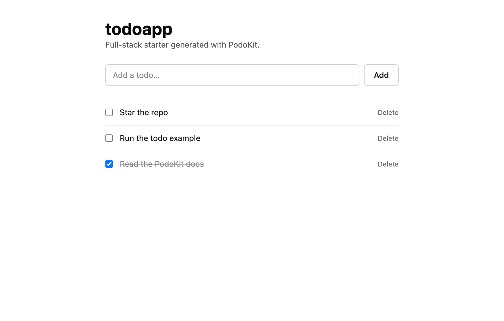
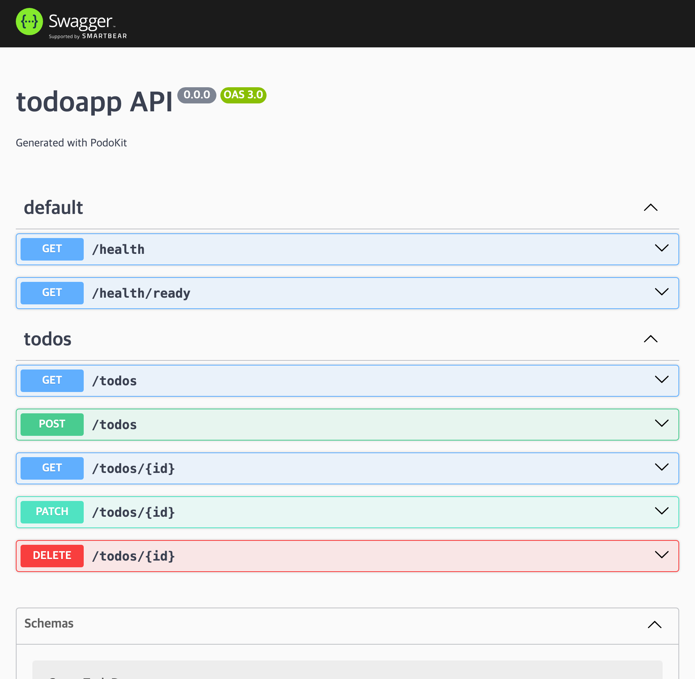

# Templates

`podo create --template <name>` selects one of three Bun 1.4 templates.
`--database postgres|sqlite` selects the initial database provider, defaulting to
`postgres`. Template choice and infrastructure choice are independent.

| Template | Description |
|---|---|
| `fullstack` (default) | Bun + Elysia + SvelteKit foundation without domain code |
| `todo` | Fullstack plus a tested Bun.SQL Todo CRUD example |
| `base` | Minimal Bun workspace |

The CLI accepts `--runtime bun` as an explicit selection. Node and alternative
package-manager targets do not exist in PodoKit v1.

```bash
npx @podosoft/podokit create my-app
bunx --bun @podosoft/podokit create my-app --template todo
```

For a simple application, keep the Elysia/SvelteKit foundation and select
SQLite, memory cache/events, local files, and local jobs. `base` is a skeleton
with placeholder scripts, not the way to select lighter infrastructure.
`fullstack` and `todo` support either database; `base` does not include database
integration or the provider-consuming module foundation.

| Capability | Default | Other choice |
| --- | --- | --- |
| `database` | `postgres` | `sqlite` |
| `cache` | `redis` | `memory` |
| `object-storage` | `s3` | `local` |
| `events` | `redis` | `memory` |
| `jobs` | `bullmq` | `local` |

Only `database` is selected with a `create` flag. Other providers are configured
after creation using `podo provider set <capability> <provider> --apply`.
SQLite selection alone leaves the other defaults unchanged. Follow
[Getting Started](getting-started.md) for complete server and local setup steps,
or [Runtime providers](providers.md) for settings and module installation.

## `fullstack`

```text
apps/
  api/
    src/
      main.ts              # Elysia startup and Bun.serve
      app.ts               # assembled module/plugin registrations
      app.extensions.ts    # application-owned service/module extension point
      core/                # service registry, access policy, API contract
      database/            # provider-aware Bun.SQL connection and migrations
      health/              # GET /health and /health/ready
      common/              # AppException and standard error envelope
    scripts/build.mjs      # Bun.build API, worker, and migrations (+ migrations.json)
    scripts/run-migrations.mjs # migrate:all: source in development, dist in production
    Dockerfile             # oven/bun:1.4.0-alpine
  web/
    src/routes/            # SvelteKit pages, API proxy, and GET /healthz
    src/lib/i18n/          # English and Korean JSON catalogs
    src/lib/components/ui/ # vendored shadcn-svelte primitives
    Dockerfile             # oven/bun:1.4.0-alpine
infra/
  docker/                  # provider-aware development services
  k3s/                     # reference resources
tests/                     # Playwright API and UI e2e suites
bun.lock
```

The request path uses Elysia and Bun.SQL with PostgreSQL or SQLite. TypeORM
executes PostgreSQL migrations; SQLite uses the local migration runner.
The API listens on `HOST` (default `0.0.0.0`) and `PORT`; set `HOST=127.0.0.1`
to keep it off the network, for example in a desktop shell.
`bun run --cwd apps/api migrate:all` is the one migration command for setup,
after adding a module, and for the deployment migration job. It runs the source
in development and the compiled output in a production image, and with the
`auth` module installed it applies the Better Auth schema before the application
migrations. `migration:run` and `migration:revert` work on the application
migrations alone, so `migration:run` never creates Better Auth tables, and a
module migration that needs one, such as the admin dashboard's session index,
stops and names `migrate:all`.

`scripts/build.mjs` keeps `process.env.NODE_ENV` a read of the runtime
environment in every bundle. Left to its default, `Bun.build` replaces it with
`"development"`, so the built API, its dependencies included, would skip every
production branch even with `NODE_ENV=production` set. The build also compiles
each `src/migrations/<timestamp>-<name>.ts` to `dist/migrations/<timestamp>-<name>.js`
and lists them with their names in `dist/migrations/migrations.json`. It fails
when a migration lands anywhere else, when a file does not export exactly one
migration class, or when the output does not match the sources, and it removes
the compiled migrations of an earlier build first. In production
(`NODE_ENV=production` with a `dist` directory) the migrators run the listed
files and nothing else, and refuse to run when the list or a listed file is
missing. Both migrators also fail when they load fewer migrations than the list
or the source directory holds, because TypeORM loads nothing, without an error,
from a path that matches no file.

Application entities go in `APP_ENTITIES` of the owned
`apps/api/src/database/entities.ts`; the API's `tsconfig.json` enables the
legacy decorators and design-type metadata TypeORM entities need. With the
database running, `bun run --cwd apps/api migration:generate src/migrations/<Name>`
writes a migration for the difference between the entities and the schema. The
TypeORM CLI runs on Bun, which loads the data source like the API does.

`bun run --cwd apps/api migrate:list` prints the name of every migration the
current build would run, without a database, for example to inspect an image:
`docker run --rm <api-image> bun run migrate:list`. In production the API
refuses to start without the list, and `GET /health/ready` reports a
`migrations` check that stays down while the database lacks a listed migration,
so an orchestrator holds traffic until the migration job has run.

Other infrastructure is selected
through the contracts described in [Runtime providers](providers.md). The merged
OpenAPI document at `/api-docs-json` includes
Elysia, module, and Better Auth routes. `bun run --cwd apps/api contract`
compares that document with the generated project manifest, and requires each
operation in `APP_DOCUMENTED_ROUTES` of the owned
`apps/api/src/core/api-contract.extensions.ts` to be both registered and
documented.
The API reuses the merged document until the route count changes or an OpenAPI
contributor returns a different document object. A contributor should therefore
return the same object while its inputs are unchanged. The auth module keeps one
Better Auth document per auth instance, so an auth configuration rebuild
regenerates it, and a failed generation is retried on the next request.

Routes are session-protected by default when `auth` is installed. Modules use
the startup service registry and explicitly register public or API-key access.
A rule registered for `GET` also covers `HEAD`, which Elysia answers with the
GET handler and Bun sends without the body; register a `HEAD` rule to treat it
differently.

The registry starts work in two ways. `services.onStart(start)` runs before the
server listens, in registration order, and a rejection stops startup, so use it
only for work that cannot fail because a dependency is down. A connection to
another service goes through `services.supervise(name, connection)` instead:
`connection.connect()` opens whatever is closed and restores what depends on it,
such as subscriptions, and the optional `connection.onLost(listener)` hands over
a callback to run when an open connection drops. The registry makes one attempt
before the start hooks run and then reconnects in the background with capped
backoff, so the API listens while the service is down. Register a readiness
check for the dependency so `/health/ready` reports it (see
[Health probes](deployment.md#health-probes)).

```ts
services.resolve(READINESS).register("search", () => search.ping());
services.supervise("search", search);
```
The backend always renders failures as:

```json
{
  "success": false,
  "error": {
    "code": "STABLE_CODE",
    "message": "Readable message",
    "statusCode": 400,
    "path": "/example",
    "timestamp": "2026-08-24T00:00:00.000Z"
  }
}
```

The browser calls only the SvelteKit `/api/*` proxy. Cookies and internal API
origins stay server-side.

### Proxy headers

The managed `apps/web/src/lib/server/backend-proxy.ts` forwards an allowlist of
request headers to the API (cookies, authorization, content negotiation,
conditional and range requests, the user agent) and relays an allowlist of
response headers back (content and caching headers, `location`, rate-limit
headers, `x-next-cursor`, and `set-cookie`). Every other header is dropped.

The proxy relays the API's `content-length` unless the body was compressed.
Bun sends a streamed body with chunked encoding and drops its length unless the
body is in memory, so the proxy reads a body of up to 2 MiB with a known length
before relaying it, such as a profile image or a JSON response, and streams
larger ones through, chunked.

Add the headers your own API uses to the application-owned
`apps/web/src/lib/server/proxy-headers.ts`:

```ts
export const APP_FORWARDED_REQUEST_HEADERS: readonly string[] = ["x-api-key", "mcp-session-id"];
export const APP_RELAYED_RESPONSE_HEADERS: readonly string[] = ["x-checksum-sha256", "www-authenticate"];
```

The proxy merges these into its lists, lowercased and without duplicates. A name
that is not a valid header token, or one the proxy handles itself, fails the web
build and tests: hop-by-hop headers (`connection`, `transfer-encoding`,
`upgrade`, and the like), `host`, `content-length`, the client address headers
(`forwarded`, `x-forwarded-*`, `x-real-ip`), and on responses
`content-encoding` and `set-cookie`, which the proxy already relays. New apps
get the file empty; `podo update` creates it once in an existing app and never
overwrites it.

The proxy also tells the API which public origin a request came in on, in
`x-forwarded-host` and `x-forwarded-proto`. The values come from the request URL
SvelteKit resolved, from the `Host` header or from the gateway headers that
`HOST_HEADER` and `PROTOCOL_HEADER` name, never from a caller's own forwarded
headers, and the proxy sends them only when that origin is listed in
`CORS_ORIGIN`. The server-side API client used by hooks and loaders sends the
same pair. An API route that builds links for the browser, such as a connection
URL shown on a page, can use them to pick the origin the visitor used and fall
back to the first `CORS_ORIGIN` entry. The API must still accept only origins it
is configured for, because a caller that reaches it directly can send anything.
A web image built with `PODOKIT_BUILD_ORIGIN` resolves every request to that
origin, so it reports only that one.

### Proxy path rules

`APP_BODY_LIMITS` and `APP_PROXY_TIMEOUTS` below select `/api` routes by
`pathPrefix`, and the rate-limit module's
[route profiles](modules.md#route-profiles) select API routes the same way:

- A prefix covers its path and every path below it, by whole segments:
  `/api/files` covers `/api/files` and `/api/files/1`, not `/api/files-old`. A
  trailing slash makes no difference.
- A `:name` segment matches exactly one non-empty path segment:
  `/api/hosts/:hostId/file-transfers` covers `/api/hosts/h1/file-transfers` and
  the paths below it, but neither `/api/hosts/file-transfers` nor
  `/api/hosts/h1/file-transfers-old`. The name is a letter or `_` followed by
  letters, digits, or `_`, and only documents the segment.
- When several prefixes cover a path, the most specific wins: the one with more
  segments; at equal length, compare segments from the left, and the first
  place where one has a literal segment and the other a parameter decides for
  the literal. So `/api/hosts/local/:section` wins over
  `/api/hosts/:hostId/files` for `/api/hosts/local/files`. The web lists reject
  two prefixes that cover the same paths, such as `/api/a/:x` and `/api/a/:y`;
  rate-limit routes fall back to the method and the latest registration.
- The web lists match the decoded request path, so an encoded segment such as
  `%66iles` cannot step around a prefix. Prefixes there start with `/api/` and
  use URL path characters; empty, `.`, and `..` segments, wildcards such as `*`,
  and malformed parameters fail when the web server loads the proxy and in the
  web tests.

### Request body limits

`BODY_SIZE_LIMIT` (3 MiB in the generated `.env.example`, web Dockerfile, and
Kubernetes config) is the ceiling for every web route. adapter-bun passes it to
`Bun.serve` as `maxRequestBodySize`, so Bun enforces it before SvelteKit or the
proxy runs: a request whose `Content-Length` exceeds it gets 413 with an empty
body and a closed connection, and a chunked body without `Content-Length` fails
once it passes the limit while being read, with the same 413. Neither response
carries the error envelope.

Below that ceiling, cap individual `/api` routes in the application-owned
`apps/web/src/lib/server/body-limits.ts`:

```ts
export const APP_BODY_LIMITS: ReadonlyArray<{ pathPrefix: string; maxBytes: number }> = [
  { pathPrefix: "/api/feedback/", maxBytes: 64 * 1024 },
  { pathPrefix: "/api/hosts/:hostId/file-transfers", maxBytes: 1024 * 1024 + 64 * 1024 },
];
```

Entries select routes by the [proxy path rules](#proxy-path-rules). The proxy rejects a declared
`Content-Length` above the limit at once and otherwise counts the body as it
streams in, stopping at the limit without buffering the rest. Either way it
answers 413 with the standard envelope, code `PAYLOAD_TOO_LARGE` and
`details.maxBytes`, without contacting the API. Routes without an entry keep the
server-wide ceiling. An invalid prefix or a `maxBytes` that is not a positive
whole number fails the web build and tests.

These limits can only lower the ceiling: a `maxBytes` above `BODY_SIZE_LIMIT`
has no effect, because Bun rejects the body first. Raising `BODY_SIZE_LIMIT`
raises it for every page, form action, and endpoint, and the web process still
holds each proxied body in memory. For uploads larger than the ceiling, list the
upload route in `apiPaths` so the gateway sends it straight to the API; see
[direct API paths](deployment.md#direct-api-paths). An app that splits uploads
into chunks small enough for the web proxy can send larger parts that way.

### API timeouts and outages

The web server bounds its calls to the API, so a page does not wait for an API
that has stopped answering:

- Each server-side call through `serverApiClient`, such as the hooks' site
  settings and session lookups, may take `BACKEND_TIMEOUT_MS` (2000 by default),
  reading the response body included, and then rejects with a `TimeoutError`.
  The hooks treat that like any other outage: public pages render their
  fallbacks and protected pages answer `503`.
- The `/api` proxy waits up to `BACKEND_PROXY_TIMEOUT_MS` (30000 by default)
  for the response headers and then answers
  `504` with the `BACKEND_TIMEOUT` error code. The wait ends when the headers
  arrive, so server-sent events and large downloads keep streaming. A refused
  connection or any other failure without an HTTP answer becomes `503`
  `BACKEND_UNAVAILABLE` with `Retry-After: 2` instead of SvelteKit's bare `500`.
  Both use the standard error envelope and `Cache-Control: no-store`.

When a call gets no HTTP answer, and every `BACKEND_TIMEOUT_MS` while the proxy
waits for response headers, the web server requests the API's `GET /health` with
the same bound, unless another check ran within that time. Only when that check
gets no answer either is the API treated as unreachable, so one slow endpoint
does not fail other requests, while an API that stops answering partway through
a long wait still ends it. Then requests
still waiting for the API fail at once, new server-side calls throw
`BackendUnavailableError` from `#lib/server/api.js` without contacting the API,
and the proxy answers `503` at once. A background check runs at most every two
seconds while requests arrive, and the first HTTP answer, whatever its status,
ends the outage. The state belongs to one web process.

Both values are whole milliseconds from 1 to 2147483647, set in the web
server's environment; any other value fails when the web server loads the
proxy. That is at startup in apps with server hooks, such as the admin
dashboard's; otherwise the first `/api` request loads it, and every `/api`
request answers `500` and logs the error. Raise
`BACKEND_TIMEOUT_MS` when a load function calls an endpoint that takes longer;
it also lengthens how long pages wait while an outage is being detected. An API
endpoint that takes longer than 30 seconds to start its response needs a longer
proxy deadline and both idle timeouts raised with it; see
[proxy deadlines per route](#proxy-deadlines-per-route).

The built web server (adapter-bun) closes a connection that has sent nothing for
`CONNECTION_IDLE_TIMEOUT` seconds, without any response, so neither the API's
late answer nor the proxy's `504` reaches the browser. The generated web image,
`.env.example`, reference Kubernetes config, and deployment renderers set it to
35. Bun checks idle connections every 4 seconds and can close one up to 4
seconds early, so the value must be more than 4 above the longest proxy deadline
in seconds; 35 covers the default 30-second deadline, and the API's
`API_IDLE_TIMEOUT` follows the same rule (see
[proxy deadlines per route](#proxy-deadlines-per-route)). Bun accepts at most 255,
and `0` turns the idle timeout off. When the variable is set, the proxy refuses
to load unless it is `0` or covers `BACKEND_PROXY_TIMEOUT_MS` and every
`APP_PROXY_TIMEOUTS` entry, and a route without a deadline needs `0`. Unset,
Bun's default of 10 seconds applies and is not checked. adapter-bun lifts the
timeout for `text/event-stream` responses, so server-sent events stay open
through quiet periods; any other streamed response that pauses for longer is
cut off. Only the built server reads the variable; `vite dev` does not. Calling Bun's
`server.timeout(request, 0)` through `platform.server` in a route does not help:
behind an HTTPS gateway, adapter-bun rewrites the request onto the public
origin, and Bun ignores the call for the rewritten request.

### Proxy deadlines per route

Some endpoints take longer than `BACKEND_PROXY_TIMEOUT_MS` to start their
response by design, such as a report export or a request that waits for a
background worker, and some should give up sooner. Set their deadlines in the
application-owned `apps/web/src/lib/server/proxy-timeouts.ts` instead of editing
the managed proxy:

```ts
export const APP_PROXY_TIMEOUTS: ReadonlyArray<{ pathPrefix: string; timeoutMs: number | null }> = [
  { pathPrefix: "/api/exports/", timeoutMs: 120_000 },
  { pathPrefix: "/api/hosts/:hostId/file-transfers", timeoutMs: null },
];
```

Entries select routes by the [proxy path rules](#proxy-path-rules); other
routes keep `BACKEND_PROXY_TIMEOUT_MS`. `timeoutMs` is how long the proxy waits for the
response headers before it answers `504` `BACKEND_TIMEOUT`, and `null` waits as
long as the API takes. The health checks keep running while a request waits, so
a route without a deadline still answers `503` `BACKEND_UNAVAILABLE` once the
API's `GET /health` stops answering, and the wait also ends when the browser
disconnects. The deadline ends when the headers arrive, so it never cuts off
the body. Bun's `fetch` also gives up on an API connection that sends nothing
for its idle timeout, 300 seconds unless `BUN_CONFIG_HTTP_IDLE_TIMEOUT` sets
another; the proxy turns that timeout off for a route without a deadline or with
one of 300 seconds or more, so the deadline alone ends the wait. An invalid
prefix, two prefixes that cover the same paths, or a `timeoutMs` that is
neither `null` nor a whole number of milliseconds from 1 to 2147483647 fails the
web tests and the web server when it loads the proxy.

The proxy's deadline is one of three limits on such a request, and the other
two have to be raised with it. Bun runs both the API and the built web server and
checks idle connections every 4 seconds, so it can close a silent connection up
to 4 seconds before its idle timeout. Each idle timeout must therefore be more
than 4 seconds above the longest wait, in whole seconds:

| Proxy deadline | `API_IDLE_TIMEOUT` (API) | `CONNECTION_IDLE_TIMEOUT` (web) |
| --- | --- | --- |
| `BACKEND_PROXY_TIMEOUT_MS` of 30000 (default) | 35 (default) | 35 (default) |
| `timeoutMs: 120_000` | at least 125 | at least 125 |
| `null`, or above 250000 ms | `0` | `0` |

Both are environment variables from `0` (off) to `255` seconds. Set them in
`.env`. `podo deploy` derives both from `BACKEND_PROXY_TIMEOUT_MS` and this file
when a profile's `runtimeConfig` leaves them unset; it reads the file without
running it, so keep each entry a literal `{ pathPrefix: "...", timeoutMs: ... }`
(see [deployment idle timeouts](deployment.md#idle-timeouts)). The API's
`idleTimeout` in its [server options](#api-server-options) wins over
`API_IDLE_TIMEOUT`. With `0`, idle keep-alive connections stay open until the
client or the gateway in front closes them. If the API closes the connection
first, the proxy answers `503` `BACKEND_UNAVAILABLE`; if the web server does, the
browser gets an empty reply. The proxy refuses to load when
`CONNECTION_IDLE_TIMEOUT` cannot cover an entry here. New apps get the file
empty; `podo update` creates it once in an existing app and never overwrites it.

### Fallback error page

When the root layout or a server hook fails, for example with 503 because the
API is down, SvelteKit cannot render the app's pages and serves
`apps/web/src/error.html` instead. The generated page is self-contained HTML
with inline styles that follow the light or dark color scheme. It shows only the
status and the error message, so it needs no translations. Customize it freely:
it is application-owned, and `podo update` creates it once in an existing app and
never overwrites it, including an `error.html` the app already has. SvelteKit
fills in only `%sveltekit.status%` and the HTML-escaped
`%sveltekit.error.message%`. It cannot use components, app CSS, scripts, or
assets, because SvelteKit sends it as a plain template outside the app's
rendering and build.

### Client address

The API resolves each caller's address once per request, before any guard,
Better Auth, or handler runs, and every part of the API uses that one address:
Better Auth's session `ipAddress` and its own per-address limits, audit entries,
and the rate limiter.

| Setting | Default | Effect |
| --- | --- | --- |
| `TRUSTED_PROXY_HOPS` | `0` in code; `1` in the generated `.env.example`, `.env.docker.example`, Kubernetes example, and what `podo deploy` renders | Reverse proxies in front of the API whose forwarded header is trusted. With `0` the address is the socket peer. With `n`, it is the entry `n` places left of the peer in the header, the one the outermost trusted proxy appended; entries further left were written by the caller and are ignored. A shorter chain or a malformed entry falls back to the peer. |
| `TRUSTED_PROXY_HEADER` | `x-forwarded-for` | The header the trusted proxies append the address to. |

The web app's `/api` proxy and the deployment gateway are each one proxy, so the
generated configuration uses 1. Count only proxies that every request passes
through: with 1, a caller that can reach the API directly chooses its own
address. The settings replace the rate-limit module's
`RATE_LIMIT_TRUSTED_PROXY_HOPS` and `RATE_LIMIT_PROXY_HEADER`, which the API
now refuses at startup.

The API records the result in the `x-podokit-client-address` request header,
replacing any value a caller sent. Read it with `clientAddressOf(request.headers)`
from `apps/api/src/core/client-address.ts` rather than reading `X-Forwarded-For`
yourself; request guards also receive it as `clientAddress`.

### API server options

`main.ts` is managed, so applications set Bun server options through the
`apiServerOptions` export of the owned `apps/api/src/app.extensions.ts`:

```ts
import type { ApiServerOptionsSource } from "./config/server-options";

export const apiServerOptions: ApiServerOptionsSource = {
  maxRequestBodySize: 1024 ** 3, // bytes per request body
  idleTimeout: 120, // seconds, 0 to 255
};
```

| Option | Default | Effect |
| --- | --- | --- |
| `maxRequestBodySize` | `API_MAX_REQUEST_BODY_SIZE`, else 128 MiB (Bun's default) | Larger bodies are refused with `413` before a handler runs. |
| `idleTimeout` | `API_IDLE_TIMEOUT`, else 35 seconds | How long a connection may stay idle, from 0 to 255 seconds; `0` disables the timeout. 35 outlasts the web proxy's 30-second deadline; a longer deadline needs a longer idle timeout, see [proxy deadlines per route](#proxy-deadlines-per-route). |

Values in the export win over the environment. Export a function to derive
them from the validated environment instead, for example
`(env) => ({ maxRequestBodySize: Math.max(env.API_MAX_REQUEST_BODY_SIZE, 1024 ** 3) })`.
The export is optional: an `app.extensions.ts` written before it existed keeps
compiling, and `API_MAX_REQUEST_BODY_SIZE` and `API_IDLE_TIMEOUT` still apply.
Invalid values stop the API at startup. Requests through the web app's `/api` proxy are also
bounded by the web server's `BODY_SIZE_LIMIT`.

### Shutdown

On `SIGTERM` or `SIGINT` the API and the built web server stop the same way:

1. They stop accepting connections. The API's `GET /health/ready` answers `503`
   `SHUTTING_DOWN` on connections that are still open.
2. They end server-sent event streams at once, and the API closes the WebSockets
   that registered for shutdown with code `1001` (Going Away). Streams and
   sockets never finish on their own, so waiting for them would hold the process
   until the orchestrator kills it; their clients reconnect to another instance
   instead. The `sse` module's streams and every stream the web server's `/api`
   proxy relays end this way.
3. In-flight requests get up to `SHUTDOWN_TIMEOUT` seconds (30 unless set) to
   finish. Both servers read the same variable, and the rendered Kubernetes grace
   period follows it.
4. Whatever is still open then is closed. The API closes its services (the
   database pool, Redis, and the others), waiting up to 3 seconds for them, and
   exits.

A second signal exits at once. A stream or WebSocket of the application's own
registers through the `SHUTDOWN` service; otherwise it stays open until the
timeout and is then cut:

```ts
import { Elysia } from "elysia";
import type { PodokitModule } from "./core/services";
import { GOING_AWAY } from "./core/shutdown";

export const terminalModule: PodokitModule = {
  name: "terminal",
  plugin: ({ shutdown }) => {
    const releases = new Map<string, () => void>();
    return new Elysia().ws("/terminal", {
      open(ws) {
        releases.set(ws.id, shutdown.onShutdown(() => ws.close(GOING_AWAY, "Server shutting down")));
      },
      close(ws) {
        releases.get(ws.id)?.();
        releases.delete(ws.id);
      },
    });
  },
};
```

`onShutdown(listener)` runs the listener when shutdown starts, or at once when it
already has, and returns a function to call when the connection closes on its own.
Code that takes an `AbortSignal` can use `shutdown.signal`, and code outside a
plugin resolves the same object with `services.resolve(SHUTDOWN)`. To end a server-sent
event stream, close its `ReadableStream` controller in the listener, so the
response ends cleanly and `EventSource` reconnects.

### Web extension points

The web app's framework files are managed so that `podo update` can keep them
current. Put application changes in these application-owned files instead; each
is created once, by `podo create`, `podo add`, or the first `podo update` that
ships it, and never overwritten.

| File | Export | Purpose |
| --- | --- | --- |
| `apps/web/vite.extensions.ts` | `appViteConfig`, `appSvelteKitConfig` | Vite options merged into the managed `vite.config.ts`, and SvelteKit options passed to `sveltekit()` |
| `apps/web/src/app.extensions.css` | | Styles the managed `app.css` imports last: `@source` paths, theme variable overrides, `@theme` entries, base styles ([UI foundation](#ui-foundation)) |
| `apps/web/src/lib/server/proxy-headers.ts` | `APP_FORWARDED_REQUEST_HEADERS`, `APP_RELAYED_RESPONSE_HEADERS` | [Proxy headers](#proxy-headers) |
| `apps/web/src/lib/server/body-limits.ts` | `APP_BODY_LIMITS` | [Request body limits](#request-body-limits) |
| `apps/web/src/lib/server/proxy-timeouts.ts` | `APP_PROXY_TIMEOUTS` | [Proxy deadlines per route](#proxy-deadlines-per-route) |
| `apps/web/src/error.html` | | [Fallback error page](#fallback-error-page) |
| `apps/web/src/lib/server/app-hooks.ts` (admin-dashboard) | `appHandle` | [Request hook](modules.md#request-hook) |
| `apps/web/src/lib/server/public-paths.ts` (admin-dashboard) | `APP_PUBLIC_PATHS` | [Public pages](modules.md#admin-dashboard) |
| `apps/web/src/lib/server/asset-paths.ts` (admin-dashboard) | `APP_ASSET_PATHS` | [Endpoints without the session](modules.md#admin-dashboard) |
| `apps/web/src/lib/server/non-indexable-paths.ts` (admin-dashboard) | `APP_NON_INDEXABLE_PATHS` | [Search indexing](modules.md#search-indexing) |
| `apps/web/src/lib/admin/app-nav.ts` (admin-dashboard) | `APP_ADMIN_NAV` | [Admin navigation](modules.md#admin-navigation) |
| `apps/web/src/lib/admin/app-flags.ts` (admin-dashboard) | `APP_FLAG_SETTINGS` | [Application settings](modules.md#application-settings) |

Route pages are owned too; see [route files and update tiers](#route-files-and-update-tiers)
for the pages whose server load PodoKit manages. So are the project's
`README.md`, `tests/README.md`, `.gitignore`, `.env.example`,
`.env.docker.example`, and `infra/k3s/**`; see [updating](updating.md#project-metadata).

#### Vite and SvelteKit options

`apps/web/vite.config.ts` is managed. It merges `appViteConfig` from the owned
`apps/web/vite.extensions.ts` into its own configuration with Vite's
`mergeConfig`, so lists such as `plugins` are appended and objects are merged
key by key, and spreads `appSvelteKitConfig` into the `sveltekit()` options
after `adapter` and `preprocess`:

```ts
import type { Config as SvelteKitConfig } from "@sveltejs/kit/vite";
import type { UserConfig, UserConfigFnObject } from "vite";

export const appViteConfig: UserConfig | UserConfigFnObject = {
  server: { warmup: { clientFiles: ["./src/routes/+layout.svelte", "./src/routes/+page.svelte"] } },
  optimizeDeps: { include: ["zod"] },
  define: { __APP_VERSION__: JSON.stringify(process.env.npm_package_version ?? "") },
};

export const appSvelteKitConfig: SvelteKitConfig = {
  alias: { $i18n: "src/lib/i18n" },
};
```

A function receives Vite's `{ command, mode }`. `PODOKIT_BUILD_ORIGIN` still sets
`paths.origin` at build time. The generated `compose.dev.yaml` restarts the web
container when the file changes.

#### WebSocket paths in host development

A SvelteKit route cannot answer a WebSocket upgrade. The `podo dev` gateway and a
deployment's edge send the exact paths listed in `webSocketPaths` of
`.podokit/dev.json` straight to the API (see
[containerized development](development.md#containerized-development)). For
`bun run dev`, the managed `vite.config.ts` reads the same list and proxies each
exact path, with or without a query string, to `BACKEND_INTERNAL_URL`, so a
WebSocket feature works the same way in both setups without a proxy entry of
your own. The API must authenticate each upgrade itself.

#### Browser errors in the dev server output

When hydration fails in the browser, for example because a module request
failed, and the root error page cannot load either, SvelteKit renders
`src/error.html` in the browser. The server answered the page with 200 and has
no error of its own to log. The managed `vite.config.ts` therefore sets Vite's
`server.forwardConsole` to `{ unhandledErrors: true, logLevels: ["error"] }`,
so the dev server prints the browser's uncaught errors and `console.error`
messages, such as `[Unhandled rejection] TypeError: Failed to fetch dynamically
imported module: ...`, with its own output and the container log. Set
`server.forwardConsole` in `appViteConfig` to change the levels, or to `false`
to turn it off.

### Route files and update tiers

`apps/web/src/routes/**` is application-owned, but modules keep some route
server loads managed, such as `routes/account/+page.server.ts` and the admin
pages' loads, so that security and data fixes still arrive through
`podo update`. The owned page beside such a load never receives updates, so
PodoKit keeps each feature of those routes in managed files:

- The owned page passes the load's `data` to a managed component, such as
  `<AccountPage {data} />`, and reads only the fields earlier versions of the
  page already read. A test in the PodoKit repository fails when a template
  page starts reading another one.
- A field a managed load starts returning is rendered by a managed component.
  For example, the impersonation banner on `/account` is part of the managed
  `AccountPage`, driven by the load's `showImpersonationBanner`.
- A managed e2e spec keeps passing against the owned pages earlier versions
  generated, so it does not assert a change PodoKit made only to an owned page.

Keep your own chrome in the owned page and leave the `data` it passes on
unchanged. If a managed load must change, `podo eject` it together with the
page.

## `todo`

The Todo template adds:

- an Elysia plugin for `GET/POST/PATCH/DELETE /todos`;
- a Bun.SQL repository;
- a numbered provider-aware migration;
- a SvelteKit Todo page; and
- unit/API/UI tests.

```bash
npx @podosoft/podokit create podokit --template todo --database sqlite
cd podokit
bun install
cp .env.example .env
bun run --cwd apps/api migrate:all
bun run dev
```

This example uses SQLite and needs no PostgreSQL server. Add memory/local
providers before adding cache, upload, event, or job features to keep the app
free of external services; see the complete local setup in
[Getting Started](getting-started.md#small-app-with-local-providers).

| Web | API docs |
|---|---|
|  |  |

## `base`

The base template contains Bun workspace metadata, placeholder API/web scripts,
and a minimal API entry point. Use it to build your own foundation. For a small
working full-stack app, use `fullstack` or `todo` with local providers instead.

## UI foundation

`fullstack` and `todo` include Svelte 5, Tailwind v4, mode-watcher,
typesafe-i18n, and shadcn-svelte primitives for forms (including `input`,
`textarea`, `select`, `checkbox`, and `switch`), cards, dialogs, menus, tables,
tabs, feedback, and navigation.

Add another official component from `apps/web`:

```bash
bunx --bun shadcn-svelte@latest add accordion progress
```

`components.json` maps the CLI's `utils`, `hooks`, and `lib` aliases to the
`#lib` import map, so vendored components import `#lib/utils.js` like the
shipped ones.

Application components should wrap the vendored primitives rather than editing
`src/lib/components/ui/**`. Colors and radius are CSS variables in the managed
`app.css`, which imports the application-owned `src/app.extensions.css` last.
Put application styles there: override the variables in `:root` and `.dark`,
add `@theme` entries and base styles, and add an `@source` line for a package
whose built components use Tailwind classes, since Tailwind does not scan
`node_modules`:

```css
@import "@fontsource-variable/inter";
@source "../../../node_modules/@example/ui/dist";

:root {
  --radius: 0.5rem;
  --primary: oklch(0.48 0.2 300);
}
```
mode-watcher puts `dark` on `<html>` in dark mode and `light` in light mode, so a
component library that follows either class, and falls back to the system
setting without one, matches the theme the visitor chose.

## Dotfile convention

Template paths named `dot-<name>` become `.<name>` in generated applications,
for example `dot-gitignore` becomes `.gitignore`.

## Modules

Use `podo add <module>` to extend either fullstack template with authentication,
administration, Redis, queues, SSE, S3 storage, uploads, rate limiting, logging,
audit, Blog, Analytics, and other features. See [Modules](modules.md).
